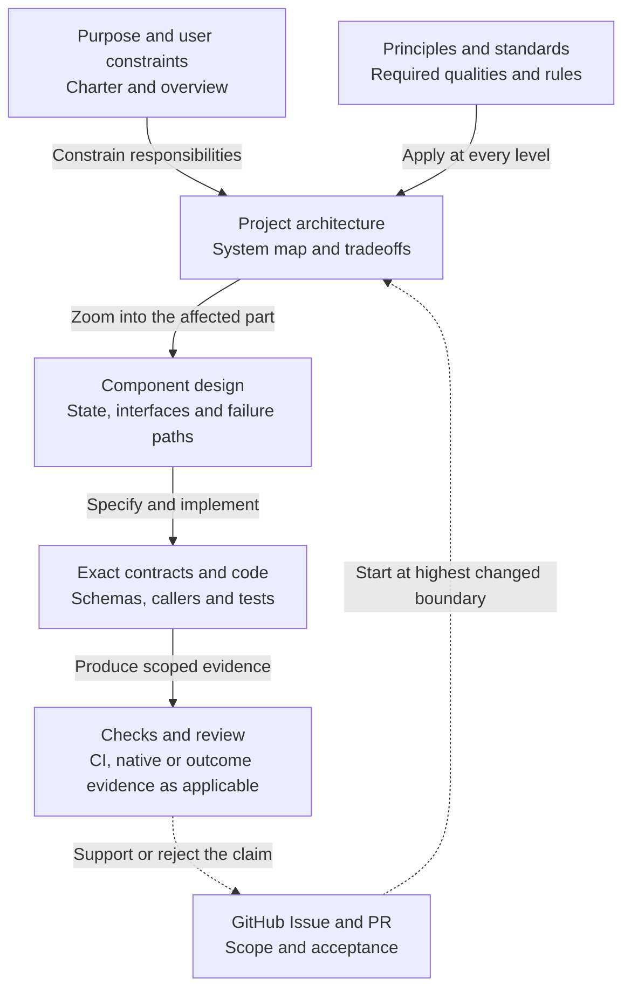

# Documentation: understand, decide, implement, verify

Start with the [overview](overview.md), then the responsibility you need to
challenge. [S-DOCS](standards/documentation.md#s-docs-useful-maintained-documentation)
owns documentation requirements. The lead maintains navigation with component
maintainers. Deciding players use the [compact guide](player-guide.md), frozen
assignment and actual tool schema; routine play does not require engineering history.

This current logical diagram answers “Where should review begin?” Arrows show
constraint or drill-down; boxes are document roles, not separate processes or
approval stages.

## Read at the level of your question

| Question | Start | Follow when needed |
| --- | --- | --- |
| Purpose and constraints | [Charter](charter.md) | [Engineering standards](engineering.md) |
| Product capability and limits | [Overview](overview.md) | [Architecture](architecture.md) |
| Ownership, state and failures | A component linked from architecture | [Contract index](protocol.md): [computer control](contracts/computer-control.md), [player host](contracts/player-host.md), [curator](contracts/curator.md), [evaluation records](contracts/evaluation-record.md); code and assertions |
| Operate a finite run | [Setup](setup.md), [runbook](runbook.md) | [Campaign procedure](operations/campaign-run.md) |
| Change scope and acceptance | GitHub Issue/PR | Affected parent/component, contract, [review policy](workflows/review.md) and [design discovery](workflows/design-discovery.md) for open boundary leaves |
| Evidence and remaining work | [Public Project](https://github.com/users/CVX-Hull/projects/2) and its issues | Run method in [development runs](development-runs.md); dated records in the [acceptance index](acceptance/index.md) and [change index](changes/index.md) |
| Checks and their limits | [Testing](testing.md) | Shared [CI selection](../tools/ci.py) and actual assertions |
| What can go wrong and what is done about it | [Risk register](risks.md) | [Controls](controls.md), then the [control rule](standards/authority.md#control-review) for adding or removing one |
| What the owner decided | [Owner decision log](decisions/owner-decisions.md) | The record or issue its row links; numbered decision records in the [decision record index](decisions/index.md) |
| What may be done without asking | [Operator permissions](operator-permissions.md) | [Owner decision log](decisions/owner-decisions.md) |
| Where a kind of fact belongs | [One authoritative home](#one-authoritative-home-per-kind-of-fact) | [S-DOCS](standards/documentation.md#current-pages-records-and-decisions), [authority and review surfaces](workflows/authority.md) |
| What a term means | [Glossary](glossary.md) | The owning page each entry links |
| What to call something | [Names](standards/documentation.md#names) | [Name mapping](acceptance/2026-11-12-control-review-and-names.md#names) for labels in historical records |

Architecture starts outside a responsibility, then explains owned state,
interfaces, important flows, failures and limits. Decompose only where a concrete
reader task or boundary benefits; no universal file-size quota applies.

## Repository boundaries

| Location | Responsibility |
| --- | --- |
| `harness/computer/` | Mechanical packets, socket, writer, store, target custody and SDL adapter; no game/player semantics. |
| `harness/player/` | Public journal, hints and fallible delivered knowledge ([player ports](contracts/player-ports.md)); no process/provider/native authority. |
| `harness/application.py` and transport adapters | Compose current ports/tools without granting observer authority. |
| `harness/evaluation/` | Interpretive run evaluation ([contract](contracts/evaluation-record.md)): game-neutral `core/` and the `cdda/` binding. It is never imported by player, computer or server code. |
| `harness/viewer/` | The read-only viewer process the spectator page reads through the gateway ([spectator view](contracts/spectator-view.md)); outside supervision. |
| `data/evaluation/` | Git-tracked human evaluation data: failure taxonomy, labels, change records, the closed archive index and reader validation; and the ledger of delegated coding-agent attempts. |
| `tools/` | Maintained setup/check/build/campaign entry points and the current player host adapter. |
| `native/` | Upstream provenance and preparation inputs, not a semantic control backend. |
| `web/` | The spectator page (served by the supervised gateway) and independent user Pause. |
| `tests/` | Scoped behavioral assertions/doubles and compiled fixtures; actual outcomes are separate evidence. |
| `docs/components/`, `contracts/`, `standards/`, `workflows/`, `operations/` | Explanation, exact rules, mandatory qualities, decisions and supported tasks. |
| `docs/design/` | Design notes: `proposed` while their owner decisions are open, `active` while one is the working description of something being built, and `historical` once that is built or the decisions went another way. An adopted design's current rules move into components and contracts. |
| `docs/research*.md` | External evidence and its limits, with a dated research cutoff; [research](research.md) indexes evidence including the [sandbox](research-curator-sandbox.md), [gate gaming](research-gate-gaming.md), [curated memory](research-curated-memory.md) and [belief under conflict](research-belief-under-conflict.md), and pages whose question is closed are `historical`. |
| [`docs/decisions/owner-decisions.md`](decisions/owner-decisions.md), [`docs/decisions/owner-decisions-archive.md`](decisions/owner-decisions-archive.md) | The owner's decisions, including permissions and limits in force, and the archive of replaced and used decisions. |
| `docs/acceptance/`, `changes/`, `decisions/` (ADRs) | Dated evidence/rationale under explicit status, not live commands or permission. `changes/` holds the change briefs written before ADRs and issues took that role; it receives no new briefs. |
| `schemas/` | JSON Schemas of persisted formats and of document front matter; the code that reads each one and its contract own its meaning. |
| Ignored `.runtime/` | Frozen inputs, owned stores/saves and raw evidence; no private maintained source framework. |

### From code to its documents

Before changing an area, read its row: the page that explains it, the page that states
its exact rules, the tests that hold them, and the diagram to update when the change
moves a boundary it shows. A delegated agent with a bounded brief needs these and the
[glossary](glossary.md), not the whole start-here set.

| Code | Explanation | Exact rules | Tests | Diagram |
| --- | --- | --- | --- | --- |
| `harness/computer/`, the native bridge | [Native control](components/native-control.md) | [Computer control](contracts/computer-control.md) | `tests/test_computer_*.py`, the compiled `tests/computer_*_check.py` | [Request collection and permanent stop](components/native-control.md#stop-collection-and-recovery-views) |
| `harness/player/`, `harness/player_tools.py`, `player_view.py`, `player_mcp.py`, `player_client.py` | [Player interface](components/player-interface.md), [journal and knowledge](components/player-interface.md#journal-and-knowledge) | [Player ports](contracts/player-ports.md), [computer control](contracts/computer-control.md), [player guide](player-guide.md) | `tests/test_player_journal.py`, `test_player_view.py`, `test_player_isolation.py` | [Basic input and collection](architecture.md#what-happens-when-the-agent-acts) |
| `harness/application.py`, `harness/server.py`, `harness/__main__.py` | [Execution](components/execution.md) | [Computer control](contracts/computer-control.md), [player ports](contracts/player-ports.md) | `tests/test_player_application.py`, `tests/test_server.py`, `tests/test_cli.py` | [Player and custody](architecture.md#scope-and-responsibilities) |
| `tools/player_host/`, `tools/campaign_*.py`, `tools/source_index.py`, `tools/configure_player_tools.py` | [Player host procedure](operations/player-host.md), [campaign procedure](operations/campaign-run.md), [supervision](operations/campaign-supervision.md) | [Player host](contracts/player-host.md), [host telemetry](contracts/player-host-telemetry.md), [player ports](contracts/player-ports.md), the adapter's closed fields in [its reference](../tools/player_host/README.md) | `tests/test_player_host_*.py`, `tests/test_campaign_*.py`, `tests/test_source_index.py`, `tests/test_recorded_player_fixture.py`, `tools/player_host/test/` | [Host request loop](contracts/player-host.md#coverage-gated-context-cut), [supervised processes](operations/campaign-supervision.md#process-ownership-and-credentials), [actor custody](architecture.md#run-ownership-and-operator-takeover) |
| `harness/curator/`, `tools/curator_host/`, `tools/knowledge_export.py` | [Curator](components/curator.md), [curator hosts](operations/curator-hosts.md), [shadow-run procedure](operations/curator-shadow-run.md) | [Curator contract](contracts/curator.md); [measurement tools](contracts/measurement-tools.md) and [withholding study](contracts/withholding-study.md) for the frozen knowledge export | `tests/test_curator_*.py`, `tests/test_knowledge_export.py`, `tools/curator_host/test/` | [Curator pipeline](components/curator.md#from-live-trace-to-delivered-knowledge) |
| `harness/evaluation/`, `harness/trace/`, `tools/evaluate.py`, `host_analysis.py`, `control_analysis.py`, `run_ledger.py`, `probe_baseline.py`, `memory_reads.py`, `memory_screen_checks.py`, `memory_measure.py`, `process_measures.py`, `knowledge_retrieval_benchmark.py`, `curator_history_recount.py`, `player_host_replay_benchmark.py` | [Development runs](development-runs.md), the [measurement guide](measurement-guide.md); the [curator component](components/curator.md) for `harness/trace/` | [Evaluation records](contracts/evaluation-record.md), [measurement tools](contracts/measurement-tools.md), [withholding study](contracts/withholding-study.md), [run ledger](contracts/run-ledger.md) | `tests/test_evaluation_*.py`, `test_host_analysis.py`, `test_memory_measure*.py`, `test_process_measures.py`, `test_run_ledger.py`, `test_probes.py`, `test_trace_*.py`, `test_knowledge_retrieval_benchmark.py`, `test_player_host_replay_benchmark.py` | `none`; `harness/trace/` is in the [curator pipeline](components/curator.md#from-live-trace-to-delivered-knowledge) |
| `tools/recurrence_research/` | [Structured recurrence research](design/structured-recurrence-research.md), [belief method comparison](design/belief-method-comparison.md) | The same design notes | `tests/test_recurrence_research_*.py` | `none` |
| `harness/viewer/`, `harness/spectator_assets.py`, `web/` | [Spectator](components/spectator.md), [viewer procedures](operations/start-observe.md#viewer-procedures) | [Spectator view API](contracts/spectator-view.md#spectator-view-api-spectator-view3), [computer control](contracts/computer-control.md#passive-spectator-reads-and-operator-pause) for Pause | `tests/test_viewer_*.py`, the browser suites `tests/test_*.cjs` | [Control path and viewer](components/spectator.md#spectator-host-operations-and-delivery) |
| `tools/check.py`, `ci.py`, `documents.py`, `document_anchors.mjs`, `evidence.py`, `.github/` | [Testing](testing.md), [CI profiles](workflows/ci-profiles.md), [evidence retention](operations/evidence-cleanup.md) | [Controls](controls.md), [S-DOCS](standards/documentation.md) | `tests/test_ci.py`, `test_devtools.py`, `test_documents*.py`, `test_document_*.py`, `test_record_indexes.py`, `test_evidence.py`, `test_host_neutrality.py` | [CI profiles and jobs](workflows/ci-profiles.md), [review hierarchy](#documentation-understand-decide-implement-verify) |
| `tools/delegate.py`, `.agents/` and each coding agent's own configuration directory | [Starting a delegate](operations/coding-agents.md#starting-a-delegate-on-any-coding-agent), [delegate profiles](operations/delegate-profiles.md) | [S-AGENT](standards/agents.md#the-leads-duties) | `tests/test_delegate.py`, `tests/test_coding_agent_attempts.py`, `tests/test_coding_agent_config.py` | `none` |
| `tools/starts.py` | [Reusable starts](development-runs.md#reusable-starts), [environment](environment.md) | [Evidence retention](operations/evidence-cleanup.md), [controls](controls.md) | `tests/test_start_*.py`, `tests/test_starts_*.py` | `none` |
| `schemas/` | The page that names each schema: the [run ledger](contracts/run-ledger.md) for run metrics and development runs, [model routing](operations/model-routing.md#reading-the-ledger) and [matched runs](operations/matched-runs.md) for the attempts ledger, [S-DOCS](standards/documentation.md) for front matter, and the [context-stability record](acceptance/2026-11-08-context-stability-489.md) for the evidence-only curator cache diagnosis | The schema file | The tests of the code that reads it | `none` |
| `tools/setup.py`, `prepare_game.py`, `patch_game.py`, `build_computer.py`, `harness/prepared_app.py`, `native/` | [Setup](setup.md), [environment](environment.md) | [Native acceptance](operations/native-acceptance.md) | `tests/test_setup.py` | `none` |
| `harness/jsonio.py` | A shared helper with no page of its own | The contract of whichever caller is changed | `tests/test_jsonio.py` | `none` |

### Follow a concrete reader task

| Task | Current route and consequence |
| --- | --- |
| Send basic control | [Player guide](player-guide.md) → [tool schemas](../harness/player_tools.py) → [computer operations](contracts/computer-control.md#computer-operations-and-custody). No game-phase/identity admission. |
| Collect uncertain input | [Player tool results](operations/player-tool-results.md) → exact original `computer_result` / `player_result`. Input remains stopped; no replay. |
| Replace an actor | [Host procedure](operations/player-host.md) → [custody contract](contracts/computer-control.md#computer-operations-and-custody). Canonical context and actual quiescence precede successor capability. |
| End automation | [Host control](contracts/player-host.md#external-control) → [campaign reserves/closeout](operations/campaign-run.md). Optional finish-up is distinct from independent permanent Pause; game saving is an ordinary player choice. |
| Save/load/exit | [Player guide](player-guide.md#ordinary-game-controls) → actual visible ordinary controls. The player judges game state; the harness certifies no save. |
| Observe play | [Start/observe](operations/start-observe.md) → [spectator component](components/spectator.md) → [spectator view](contracts/spectator-view.md) and [passive reads and Pause contract](contracts/computer-control.md#passive-spectator-reads-and-operator-pause). The viewer's recorded views and the current control target remain distinct. |
| Select validation | [Testing](testing.md) → [development policy](workflows/development.md) and [CI profiles](workflows/ci-profiles.md). Native/gameplay evidence stays separate. |
| Measure and diagnose a run | [Measurement guide](measurement-guide.md) → [evaluation records](contracts/evaluation-record.md), [measurement tools](contracts/measurement-tools.md) and [spectator view](contracts/spectator-view.md). A measurement explains part of a run; it does not certify useful progress. |

## One authoritative home per kind of fact

What is true now and how to do it belongs on a current page, in the present tense. The
last column names the wrong place a fact is often put.

| Fact | Home | Not |
| --- | --- | --- |
| Purpose and [scope of use](charter.md#scope-of-use-and-what-is-guaranteed) | [Charter](charter.md) | |
| Mandatory rules | [Engineering standards](engineering.md) | |
| Current responsibilities and assurance limits | [Architecture](architecture.md) and its components | A dated account of how it came to be |
| Exact ports, formats and APIs | The [contract](protocol.md) that names them; schemas and source for their declared executable interface | A component or design note |
| Tasks and procedures | [Setup](setup.md), the [runbook](runbook.md) and operations pages | |
| Risks defended against or excluded | [Risk register](risks.md) | A second contract or work tracker |
| Which risks a control serves, how, at what cost and with what gap | [Controls](controls.md) | A second contract or work tracker |
| Which summaries may restate what | [Authority contract](workflows/authority.md) | |
| What the owner decided | One row in the [owner decision log](decisions/owner-decisions.md) | Only a sentence in a current page, a banner on a design, or a record of its own |
| What a run, measurement or study showed | A dated record under `docs/acceptance/` | A current page |
| What a change did, why, and what was checked | Its pull request and commit message | A dated record |
| Live priorities, status, owners, blockers and exceptions | Its issue and the Project ([work items](workflows/work-items.md)) | An ADR, a design note or a current page |
| Unadopted scope | Proposals and design notes | A current contract |
| Dated rationale | ADRs | |
| External evidence and its limits | Research pages | |

[S-DOCS](standards/documentation.md#current-pages-records-and-decisions) states the
rules that follow from this table.

### Before writing or changing a document

1. **Is it true now?** State it in the present tense on the current page that owns it.
   Do not narrate how it came to be.
2. **Did the owner decide it?** Add a row to the
   [owner decision log](decisions/owner-decisions.md), in the change that acts on the
   decision or in a change of its own when nothing else changes, and link the log from
   the page that states the resulting rule. The same change marks a design note or a
   research page the decision settles `historical` (a design note that is now the
   working description of something being built becomes `active` instead), and moves a
   research page to the historical table of the [research index](research.md).
3. **Is it evidence from a run, a measurement, a study or a review?** Write one dated
   record, `docs/acceptance/YYYY-MM-DD-what-it-is.md`, with front matter `owner`,
   `status: historical`, `kind`, `date` and `scope`, opening with "At a glance", then
   run `.venv/bin/python -m tools.documents --write` to regenerate the index. A change
   whose only evidence is its diff gets no record: say it in the pull request. Where
   a grooming, a proposal or a reading of outside sources goes instead is in
   [S-DOCS](standards/documentation.md#current-pages-records-and-decisions).
4. **Is it where work stands?** Replace the issue's description; do not add a section
   to it. Set its Project fields as [work items](workflows/work-items.md) says.
5. **Is it a design for a decision?** Write a `proposed` note under `docs/design/`,
   opening with "At a glance". An architectural decision that will stand for a long
   time is an ADR under `docs/decisions/` instead.
6. **Does it use a project term?** Use the [glossary](glossary.md)'s word, or add the
   term there.
7. **Does it give a number?** Name the command or reader that produces it.

`.venv/bin/python tools/check.py --fast` checks links and anchors and runs
`tools.documents`, which checks front matter, record kinds, the opening section and
the generated indexes. Review applies the rest of this checklist
([review](workflows/review.md)).

## Lifecycle and maintenance

Use `active`, `proposed`, `historical` or `superseded` stewardship metadata according
to artifact authority. Superseded guidance names a repository-relative replacement.
A timestamp or parser pass does not establish truth. Keep original failures intact.

Historical records and superseded pages are evidence, not runnable instructions,
another supported backend or authority to import old data; they keep their original
tested scope. This covers acceptance reports, change briefs, superseded ADRs and old
executable artifacts. Their body does not change after merge, and what may be
corrected is in [S-DOCS](standards/documentation.md#current-pages-records-and-decisions);
a link whose target moves or is removed is repointed to the new home or to a commit
permalink of the old file. A replaced current page is deleted rather than kept as a
superseded copy: Git keeps it. Current pages describe the
current system and are not changelogs: what changed, when and what it replaced belongs
in Git and pull requests, what was observed belongs in dated records, and what the
owner decided belongs in the owner decision log, not in an active page.

The [archived project goal](goal.md) and [archived spectator walkthrough](walkthrough.md)
are historical entry pages.

Update parent/component/contract/callers/storage/operations together when behavior
changes. Incorporate adopted design into current pages, transfer remaining work
to GitHub and retain briefs as rationale. Preserve useful bookmarks while routing
them to the current rule. No extra backlog, registry or source-history database is
needed. C-USABILITY follows a real reader task; C-REVIEW compares claims with source.
Valid paths and anchors support these judgments but cannot replace them.
