# Documentation: understand, decide, implement, verify

Start with the [overview](overview.md), then zoom into the part you want to
challenge. This page defines the information organization required by
[S-DOCS](engineering.md#s-docs-useful-maintained-documentation); it is not a work
tracker. The lead maintains this organization with component maintainers.

This current diagram answers “Where do I start reviewing a change?” Arrows show
constraints or drill-down, not separate processes or approvals at every level.
[Editable source](diagrams/architecture-review.mmd). The table below is its text equivalent.

## Read at the level of your question

| Your question | Authoritative starting point | Next level |
| --- | --- | --- |
| Why build this; what must remain true? | [Charter](charter.md): purpose, constraints, principles | [Engineering](engineering.md): mandatory standards and policies |
| What does it do, and what remains unproven? | [Overview](overview.md): capabilities and limits | [Architecture](architecture.md): responsibilities and relationships |
| How does this part work? | The component view linked from architecture | Exact [protocol](protocol.md), schemas and linked source/tests |
| What change should we make, and why? | A scoped GitHub Issue; brief/ADR where consequential | Affected parent/component views, alternatives, contracts and acceptance |
| How do I operate it? | [Setup](setup.md), [runbook](runbook.md), [walkthrough](walkthrough.md) | Exact CLI/tool reference; [player guide](player-guide.md) for deciding players |
| What is next, blocked or being delivered? | [GitHub Project](https://github.com/users/CVX-Hull/projects/2) and linked Issues | Implementation PR and actual verification results |
| What evidence supports the claim? | [Work evidence index](work.md), dated acceptance report or CI receipt | Original retained artifacts under their declared scope |

Each architecture view explains a boundary from the outside before exposing its
internals. Describe purpose and user consequence, responsibilities and owned
state, interfaces/dependencies, important flows, failure/recovery, limitations and
links to child views/contract/code/tests. A diagram should answer a named question;
its host page explains arrows and distinguishes logical blocks from processes.
Decompose recursively where complexity or risk warrants it. A small leaf may need
only a section, docstring or schema; do not create an empty page for every class.
Cross-cutting concerns can span branches. This is a review hierarchy, not a demand
to finish all design before feedback or to mirror directories mechanically.

## One authoritative home per kind of fact

| Artifact role | Owns | Does not own |
| --- | --- | --- |
| Charter | Product intent, constraints and principles | Current implementation or work stage |
| Engineering / project-management policy | Required properties; workflow decision and trigger rules | Duplicate wire contracts or run history |
| Architecture / component explanation | Current responsibilities, state ownership, relationships, rationale links and known gaps | Per-attempt chronology or a second schema definition |
| Protocol / schema / generated reference | Exact current interfaces and invariants in their stated scope | Product direction or evidence that a run passed |
| Proposed design brief | Change scope, alternatives, selected design, questions and acceptance | Implemented support until incorporated into current contracts |
| ADR / historical brief | Decision context, alternatives and consequences at the stated date | Live implementation, task status or remaining-action queue |
| Research | Primary evidence, reading scope, uncertainty and transfer judgment | Mandatory requirements without an adopted standard/design |
| Procedure / tutorial | Supported steps for an operating task / learning task | Duplicate architecture or historical checkpoint narrative |
| Control registry → generated map | Mechanism, owner, trigger, evidence, failure response and coverage limits | Repeated standard text or chronological incident inventory |
| Dated acceptance/audit report | Candidate, observations, checks, costs, limits and finding dispositions | Current authority, future permission or live issue fields |
| GitHub Issue / Project / PR | Outcome and acceptance / stage and sequencing / implementation and review evidence | A second durable architecture reference |

Summaries may state a scoped conclusion and link evidence. They must not require
synchronized copies of changing fields or exact contracts. Current architecture
must be understandable without reading old proposals. Git owns previous source
versions; historical records preserve original observations, including failures.
An iteration's core, optional scope, appetite and decision belong in its existing
Issue, with stage/sequence in the Project. Link component designs and consolidated
evidence; do not add a local iteration backlog, a document per task or a report per
attempt. [Work scales](project-management.md#work-items-and-flow) distinguish the
iteration from commits, feedback checkpoints and finite runtime attempts.

## Lifecycle and maintenance

Use the existing frontmatter contract: `active` for maintained current guidance,
`proposed` for an unadopted design, `historical` for a dated record and `superseded`
for replaced guidance with an explicit replacement. Status describes the artifact,
not whether the associated product outcome succeeded. An accepted source design
may coexist with an unaccepted full outcome in GitHub.

Before adopting a design, incorporate its current behavior into the architecture,
component view and exact contracts; transfer remaining actions to Issues. Then
retain its brief as dated rationale. Partially adopted proposals must state their
remaining proposal scope and link the implemented contract. Dated files in
`acceptance/` are historical records even if their observations remain useful.
Do not rewrite a past failure after a repair.

On a responsibility/interface change, update the affected view and its parent
map in the same change, then linked contracts, schemas, callers, tests and operating
guides as applicable. On an outcome claim, update the overview's capability/limit
and link the dated evidence. A new attempt alone needs no overview paragraph.
Update current bodies instead of appending another checkpoint. Remove redundant
summaries and retire obsolete guidance through Git.

The existing [controls](controls.md) enforce metadata, links, generated-map
freshness, diagram rendering and selected dependency/protocol relationships.
C-REVIEW checks authority, coherence and changed-boundary diagrams; C-USABILITY
checks whether a reader can answer the intended question; C-MAINTENANCE reviews
drift and control cost at its existing triggers. Passing a parser or a date check
cannot prove meaning or maintainability. Repeated navigation failures, stale
copies, escaped defects or excessive review effort trigger repair or simplification
in the existing Issue, not a new tracker or semantic-checking framework.
