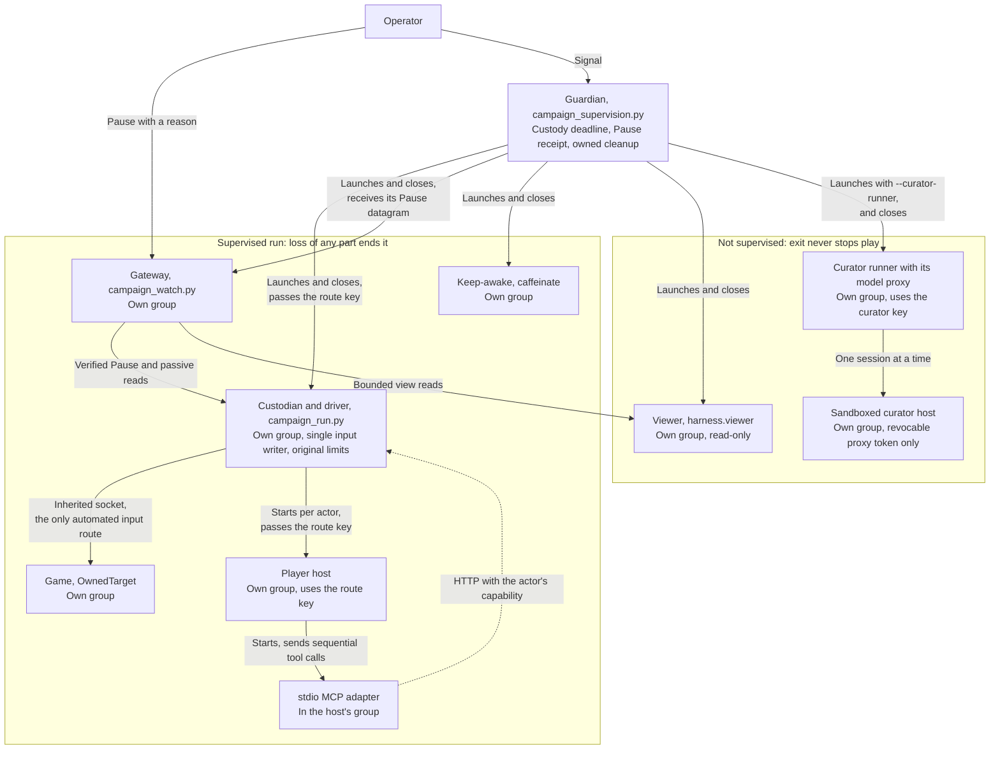

# Supervise a finite development test

The [test supervisor](../../tools/campaign_supervision.py) wraps the maintained
[campaign custodian](campaign-run.md). It belongs to test operation, outside the
player context. The independent guardian owns the original custody deadline, Pause
receipt and owned wrapper cleanup; the existing custodian owns native input,
original allowances and native/host cleanup. The gateway serves the page, relays
passive status and source reads, forwards bounded viewer reads and verified Pause, and
never actor tools. A separate read-only viewer runs outside supervision.

Nobody is required to watch a run. Supervision asks for no acknowledgement and
generates none. An unwatched run can loop, or continue after the character dies,
until a run limit or the operator's Pause stops it. The limits are the package's
original mechanical input, request, frame and byte limits, host time and dollar budget, which
the custodian enforces, and the custody deadline: the guardian terminates the
custodian at the original `wall_seconds` bound, whatever the operator conversation
is doing. The lead cancels on first observed death or replacement.

This is a Mac finite-test helper. Source delivery grants no gameplay/provider
spending or new admission. General unattended operation remains unqualified.

## Process ownership and credentials



This diagram answers “Which process owns what in one supervised run, and which can
spend or send input?” Boxes are processes and solid arrows are launches, calls or
signals as labelled; the dashed arrow is the MCP adapter's call back into the
custodian. “Own group” is a process group of its own. The frames separate processes
whose unexpected loss ends the run from those whose exit does not. Only the custodian
sends automated game input. Two processes call a
paid model: the player host with the route key, and the curator runner's proxy with its
own key. The guardian and custodian only pass the route key on; the game, MCP adapter,
gateway, keep-awake process, viewer and sandboxed curator host hold no key. The sections
below own [launch](#freeze-launch-and-inspect) and [cleanup](#failure-and-owned-cleanup).

## Freeze, launch and inspect

1. Prepare the exact clean source and fresh `campaign-run/14` package through the
   [campaign procedure](campaign-run.md). Resolve scope, spending, original
   resources, ending reserves and stop rules before admission. Preserve original
   saves and failed chains; old experiment launchers stay historical evidence.
2. Supply the selected route's credential: export its environment variable, or
   map it to your own keychain item in the git-ignored `.runtime/credentials.json`
   ([setup](../setup.md#install-the-generic-gameplay-host)). The supervisor reads a mapped
   item with `security find-generic-password` only when the variable is unset,
   and passes the value only to the custodian; gateway and keep-awake children
   receive executable lookup and locale. No global permission entry is installed.
3. Invoke from the selected checkout through engineering command permissions:

   ```sh
   .venv/bin/python -m tools.campaign_supervision --run .runtime/computer-sessions/SELECTED
   ```

   Add `--runs DIR` to let the viewer list archived run directories beside the live run.
   Repeat `--curator-drafts LABEL=DIR` to let the Curator tab read configured curator
   state directories (`drafts/` and `drafts-archive/` manifests, [draft contract](../contracts/spectator-view.md#curator-drafts)).
   Repeat `--curator-sessions LABEL=FILE` to select terminal curator close-out
   receipts by operator-supplied alias ([session contract](../contracts/spectator-view.md#recorded-curator-sessions)).
   Repeat `--curator-results LABEL=FILE` to let the Curator tab read explicitly selected
   current result journals or snapshots. Labels are unique and browser selection never
   accepts a filesystem path. These optional arguments go only to the unsupervised
   viewer; they do not change the frozen player package, credential routing, custody
   or Pause. The [recorded-result contract](../contracts/spectator-view.md#recorded-curator-results)
   owns bounds, source states and snapshot identity.

   Add `--curator-runner CONFIG` to run the [curator runner](../components/curator.md#runner-windows)
   beside play, with a `curator-runner-config/2` file
   ([`tools/curator_host/live_runner.py`](../../tools/curator_host/live_runner.py) states its fields).
   The supervisor then creates `curator-read.lock` and the runner's directory
   `curator-runner/` in the run directory before the custodian starts, and starts the
   runner after the custodian as an unsupervised child, without the route credential:
   its environment is the gateway's and `HOME`, so it resolves its own provider key
   from the keychain item mapped in `.runtime/credentials.json`.
   A package that sets [`live_knowledge_updates`](campaign-run.md#live-knowledge-updates)
   receives the versions the runner leaves in `curator-runner/delivered/`.
   Without the option neither is created. With it, a package that already holds either
   is refused before the reservation, so the refusal leaves the package usable. A live run with the runner needs the owner's
   approval of its price ([operator permissions](../operator-permissions.md)).

4. Open the exact printed gateway URL to observe play and reach Pause. The
   supervisor starts the viewer as an unsupervised child on a free loopback port; if
   the page shows **viewer unavailable**, play, the frame and Pause are unaffected, and
   the cause is in the run directory's `viewer-stderr.txt`. Its exit is never a stop.
5. Use the page's **Pause** for immediate control and choose its reason (loop,
   fault, spend or other). The page asks for a reason, but the gateway never refuses a
   stop over one: it stops first, then records the reason as given, or `unspecified`
   when it is missing or unknown. It forwards an empty Pause to the custodian and
   records the reason in `watch-terminal.json`; Pause never waits for the viewer.
   Refreshing the page cannot resume or reopen a stopped/partial package.

The page shows retained evidence: the custodian's status and the source it names,
taken from the custodian's status and source reads, never from the viewer. Human
attention, physical paint, continuous capture and useful game effects remain
separate. Repeated or older retained pixels do not become new captures.

## Failure and owned cleanup

The guardian performs no HTTP work, so blocked source or viewer reads cannot suspend
the custody deadline or delay Pause. Original custody also bounds terminal coverage:
the receipt's wall-clock end is mapped onto the monotonic clock from readiness and
must fall strictly before the custody deadline. Incomplete startup JSON is retried
under the original clocks because producers expose the pathname before buffered
close; complete invalid marker objects fail.

The expected Pause receiver comes from the newly created custodian handle, not
retained process JSON. On the supported Mac deployment, the gateway verifies the
connected loopback socket against that receiver before posting Pause. An
uncertain receiver gets no POST; the guardian still stops and owned cleanup proceeds.
This does not qualify another OS or hostile-process isolation.

On stop, signal, startup or supervision failure, custodian/gateway termination
is requested before bounded waits. Every launched child, including the viewer and Mac
`caffeinate`, receives an explicit cleanup result. A viewer that exits early or cannot
start is recorded but is not supervision loss, and never fails startup; the curator
runner is treated the same way. The viewer and the runner are terminated with the
first requests and their groups closed last, after the custodian's bounded wait.
At that point a live curator runner gets up to 15 s to finish closing its sandbox
and model proxy and write its final records. If the wait expires, the supervisor
records `grace_expired: true`. The group helper then stops any remaining group
members. The supervisor removes `curator-runner/snapshots/`,
which a killed runner can leave holding custody copies, and records a failure to do so
without raising. The runner's sandboxed curator host runs in a process group of its
own: it can outlive a forced kill of the runner, cannot spend once the runner's proxy
is gone, and is not covered by `cleanup_verified`. The shared group helper acts
only on groups created by those exact launches. Keep-awake is process-scoped.
Cleanup errors stay visible; arbitrary OS hangs, abrupt supervisor death and
native application responsiveness remain limits.

Generic stopping needs no Save, model reply or normal native exit. The player
chooses ordinary actions. Persistence, native exit, host settlement, supervision
coverage and owned absence stay distinct. Fencing inputs does not pause a live
game's clock. Apply save/reload/exit criteria in their separately frozen lane.

## Retained artifacts and assurance

| Artifact | Current version and meaning |
| --- | --- |
| `watch-start.json` | `campaign-watch-start/4`; exclusive reservation before children, binding session/source, manifest SHA256, wall/monotonic start and the planned `viewer_port`, which the gateway must match. Prior/partial markers refuse; never delete to rearm. |
| `watch-terminal.json` | `campaign-watch-terminal/4`; reason, `pause_reason` (`loop`, `fault`, `spend`, `other` or `unspecified`; null when the owner did not press Pause), the Pause clock and whether the custodian's reply was forwarded, exact children (the viewer with its pid, port and `supervised: false`, or its launch error), bounded cleanup and custodian disposition as separate facts. |
| `viewer-stdout.txt`, `viewer-stderr.txt` | The viewer's own output, created exclusively by the supervisor; diagnostics only. |
| `curator-read.lock`, `curator-runner/` | Only with `--curator-runner`: the read admission lock, created before the custodian and never replaced, and the runner's own directory (its record, status file and output, `stdout.txt`, `stderr.txt` and, for a package with live knowledge updates, the exported versions under `delivered/`). `watch-terminal.json` records the runner as `curator_runner` with `supervised: false`, or its launch error, and its cleanup with `exited_before_teardown`, `snapshots_removed` and, when the wait expired, `grace_expired: true`. |

Supervision and the gateway refuse watch records of any other version.

Current `computer-start/1`, `computer-ready/1` and `campaign-receipt/7` must match
the fresh owned custodian/session/source and chronology. A terminal receipt at or
after the custody deadline, a substituted receipt/manifest or unresolved cleanup
cannot certify supervision success. No wrapper receipt accepts gameplay or restores
custody.

[Guard/process tests](../../tests/test_campaign_supervision.py) and
[local HTTP/socket tests](../../tests/test_campaign_watch.py) exercise maintained code;
the [control-strip browser suite](../../tests/test_investigation_session.cjs) drives the page.
Fixtures establish protocol behavior, not native game effects, human takeover,
model competence or real timing. Retain failures before temporary-test pruning;
use a fresh owned directory. Actual use remains a separately frozen lane.

The engineering lead owns maintenance. Replace this helper when the
custodian/observer supplies the same independent custody deadline, verified Pause
and owned cleanup.

[Operations index](../runbook.md).
