# Project overview

This is a versioned overview, not a live process-status page.

**Enactive** is the canonical repository name. The [migration record](acceptance/2026-10-18-enactive-migration.md)
explains preserved work, historical PR records and the limits of metadata removal.

## What we are building

An agent plays CDDA-class survival/roguelike games while you watch and retain
control. Cataclysm: Dark Days Ahead is the first actual integration and validation
target. Shared player, memory, learning and orchestration designs must apply
across that class; engine/UI bindings and game-specific knowledge belong at the
integration boundary. Actual support beyond CDDA is not yet qualified. Broader
game genres remain a future extension. The [charter](charter.md) owns this current
constraint and the [architecture](architecture.md#game-family-portability) records
the intended separation and existing gaps.
The harness makes observations, actions and uncertainty visible.
It needs an active Codex player to choose plans and interpret scenes. A dedicated
player sub-agent owns planning, memory use and typed semantic requests within a
finite mission. The lead owns engineering, admission and acceptance. One local
MissionRuntime serializes execution; the user retains Pause and native takeover.

The [independent supply-and-shelter mission024](acceptance/2026-10-21-independent-supply-shelter.md)
now demonstrates the integrated path: ordinary fresh creation,1L verified usable
water, food acquisition and responsive consumption, six purposeful navigation
steps with a genuine replan, thirty actual minutes of shelter waiting, source-linked
correction/unfinished Work, actual fresh-context successor continuation, normal
save/new-child exact reload and final normal shutdown. Its return route used one
three-step target request. This is one bounded development result after23failed
attempts, not a survival guarantee, measured speedup or causal memory-benefit claim.
Source, native, graphical and protected publication/CI evidence remain separate.

Durable Claims, corrections and unfinished Work retain source support and scope.
The successor actually received all seven required retained images; their output
hashes match the archive. Claim and separate charged readmission preserve original
costs and limits. Retrieved memory never grants input authority. Actual image
presentation and independent continuation do not prove mental attention or causal
usefulness. Delivery057 adds source for reusable procedural records and a pinned
read-only library. The [failed first learning attempt](acceptance/2026-10-21-discovery-learning-first-attempt.md)
has actual scoped procedure derivation/revision/reuse, fresh-successor application
and useful play during advisory computation. It failed on a capture-identity race;
normal lifecycle and the coherent learning mission remained unqualified. The
[second attempt](acceptance/2026-10-21-discovery-learning-second-attempt.md) supports
responsive food, procedure application and the same-proposal reflection join,
but failed on lifecycle-root submission validation. The later003attempt failed
before normal adoption on control timing; #184/#185 own timing and advisory
transport repairs. All three attempts are closed failures. Their partial results
gain no normal-ending or coherent-mission credit.
The [fourth run](acceptance/2026-10-21-discovery-learning-fourth-attempt.md)
completed normal same-character save/restart/reload/final shutdown. Independent
review verifies source-linked procedure reuse, actual fresh-context application
and useful graphical work during same-proposal advisory computation with later
disposition. The lead accepts narrow changed-condition refinement; correction of
an erroneous rule and causal learning benefit remain unproved. This supports the
next fresh seven-day assessment, not seven-day success. #187 repairs a separately
reproduced advisory-finalization race: temporary
sealing must not terminate the learner. Source tests and protected publication
remain separate from graphical acceptance. The [first fresh seven-day attempt](acceptance/2026-10-21-independent-seven-day-first-attempt.md)
then failed before adoption because identity projection unnecessarily constructed
memory without its admitted library. #189uses the shared pure claim reducer
directly, retaining actual retrieval guards. The attempt is exceptionally closed;
a new fresh campaign remains required. The [second fresh attempt](acceptance/2026-10-21-independent-seven-day-second-attempt.md)
then reached normal adoption, acquired three rations and waited thirty minutes,
but failed when a zero-input menu draft revoked its consume prompt. #190 repairs
healthy correction and ordinary Escape; #191 owns systemic organic-input and
game-family portability gaps. Its 115 primitives, 64 requests, 285 images and
1,804 game seconds remain a closed partial failure, with no daily milestone or
normal ending. A fresh seven-day result is still required.

The next input-foundation work and its
[artifact impact map](changes/057-discovery-learning-campaign.md#ordinary-input-foundation-and-artifact-impact)
link current contracts, procedures, controls, learning feedback and evidence to
their backlog owners. The current foundation separates ordinary physical input
from strict semantic refresh and permits explicit Observe under healthy custody.
The [fifth learning attempt](acceptance/2026-10-22-discovery-learning-fifth-attempt.md)
failed on a native JSON-object lifetime error during the first ordinary pickup
key and remains closed. After the repair, the
[normal sixth run](acceptance/2026-10-22-discovery-learning-sixth-attempt.md)
supports current native6 discovery, scoped procedure branch refinement, actual
fresh-context application and exact normal lifecycle. Its v2 procedure is eligible
as advisory library input. A technical creation-recovery clarification is disclosed;
zero assistance, causal benefit and seven-day survival are not claimed.
Source/CI support is distinct from real qualification and game-family portability.

The [third fresh campaign](acceptance/2026-10-22-independent-seven-day-third-attempt.md)
then demonstrated an actual clean retained-memory successor and independent
exploration, but failed after258game seconds when an optional512-coordinate
navigation map stopped ordinary observation. No daily milestone or normal ending
is credited. [#193](https://github.com/CVX-Hull/enactive/issues/193) changes that
map to a bounded lossy cache, preserving evidence and current guards; source
regressions and independent source/evidence review pass. Exact73c3CI passed1,575
tests/full portable checks. The [fourth fresh campaign](acceptance/2026-10-22-independent-seven-day-fourth-attempt.md)
then supplied a reviewed real native observation prefix beyond the old bound:
345publications/530projected coordinates, with offline current projection bounded
at512. It later failed on a distinct capture-identity refusal after339game seconds;
the lease was revoked and normal save blocked. All actors/processes are closed,
with no daily milestone or normal ending. [#194](https://github.com/CVX-Hull/enactive/issues/194)
keeps the capture checks and makes proven ordinary nonpublication correctable only
after every original guard passes. The player must Observe and choose a new
intent; no old batch or failed admission resumes. New source qualification,
native assessment and protected-main acceptance remain required.
The full independent seven-day outcome is still outstanding.

The official MCP SDK adapter constructs and retains requests, collects original
results and presents exact images over the existing mission ingress. Both024
players used the then-current fifteen project-preapproved tools without visible routine
approval reviews. Hidden host review telemetry and complete model/token/quota
accounting remain unavailable. [Operator permissions](operator-permissions.md)
distinguishes setup/preapproval from runtime evidence and procedural roles from
security isolation.

The observer exposes objective/owner, historical memory/Work, cumulative requests,
charged admissions and uncertainty. The actual006terminal view separates
STOPPED/HISTORY/DISCONNECTED, no current decision and zero unresolved effects.
The subsequent viewer repair labels recorded terminal command diagnostics and
refreshes normal local credentials after a service reconnect. A paused no-game
restart verifies Pause succeeds without reloading the page; ordinary operations
are never automatically repeated. Real terminal rendering of the new diagnostic
label and paired native/browser timing remain future evidence. Historical Work
uncertainty is not silently relabeled current progress. The [observer report](acceptance/2026-10-20-mission-observer.md)
and actual mission screenshots distinguish synthetic layout tests from native
usage. The unchanged real spectator Pause qualification remains scoped user-control
evidence; no routine user tactical intervention was needed in024.

Unknown native ACKs stay unknown even when separate observed lifecycle or exact
owned-exit proofs settle their effects. Mission024 retained six such ACKs and zero
unresolved effects, with no replay. Source/native capability qualifications and
all failed independent attempts remain linked from [work](work.md); none becomes
successful through a later repair or this later result. No live mission or stale
allowance survives normal shutdown.

Current movement uses strictly known non-HOSTILE evidence. Inventory projection
omits only the engine's non-selecting cosmetic summary. Reload follows the actual
world→character-list transition and checks the unique enabled selected admitted
character before dispatch. A narrow Resume-only create/load abort exists in source;
general setup cancellation remains unsupported and unqualified.

Active observer polling now schedules250ms after each completed status response;
actual presentation latency still needs native/browser measurement. Fast ordinary
input samples do not measure player/model latency or accept independent play.
Routine play should compose guarded skills without a model or approval per key;
latency must be assessed at the whole-skill and displayed-frame boundaries too.
[Latency budgets](evaluation.md#latency-budgets-for-interactive-play) separate native
input, whole skills, model/tool delay, observer decode and loading.

The [seven-day functional campaign](acceptance/2026-10-19-seven-day-survival.md)
records the same normally created Ned Meyers / Belgium, ordinary supplies and
water treatment, shelter/rest, midpoint save/restart/exact reload, a genuine
player replacement and final normal shutdown. It reached168h02m54s, healthy and
Comfortable with displayed needs clear. The owned runtime is closed; future play
needs a new explicit admission.
This is one supervised development campaign under revised finite admissions;
earlier failures and uncertain acknowledgments remain. It establishes neither a
general autonomous survival policy nor a controlled model-performance result.

[#71](https://github.com/CVX-Hull/enactive/issues/71) owns evidence/memory readiness,
[#40](https://github.com/CVX-Hull/enactive/issues/40) outcome monitoring and
[#75](https://github.com/CVX-Hull/enactive/issues/75) workflow/control improvements.
The [work map](work.md) links current priorities and the retained campaign lineage.
[Operator permissions](operator-permissions.md) distinguishes tested literal CLI
access from rule activation and actor instructions from security isolation.

The [project goal](goal.md) records the original MVP and seven-day campaign
requirements. The [MVP completion audit](acceptance/2026-10-17-completion.md) maps
the original scope to implemented outcomes, independent review and dated gameplay
evidence; the later campaign has its own evidence above.
Direction and constraints live in the [charter](charter.md). This page summarizes
current behavior; detailed promises live in [architecture](architecture.md).

Changes migrate the system as a whole. We maintain one current version of each
contract and remove old paths, including in tools and stored metadata. Unsupported
state stops with evidence preserved until an explicit offline migration is complete.
[S-MIGRATION](engineering.md#s-migration-one-current-contract-coordinated-migration)
defines the rule and its enforcement.

## How it works

Current system context: **who decides, what you see, and where you retain control**.

Boxes show responsibilities, not separate model tiers. The player interprets
visible evidence and requests semantic operations. The mission writer accounts
for their original limits and checks live authority through the controller and
native bridge. Historical memory supports decisions but cannot authorize input.
The lead reviews engineering and admission; it is not the deciding player's
ordinary gameplay fallback. Owned lifecycle and actual fresh-context continuity
were exercised in the bounded024 mission; broader survival remains to assess. [Editable diagram](diagrams/player.mmd),
[actor contract](protocol.md#designated-campaign-operator).

CDDA decides game outcomes. The controller checks whether a requested input is
allowed in the observed state. The viewer shows actual game frames and control
state. [Architecture](architecture.md) explains these responsibilities; [decisions](decisions/001-native-platform.md)
explain why native integration was selected and when we would reconsider it.

## What works and what the evidence means

| Capability | Status and user consequence | Evidence |
| --- | --- | --- |
| Graphical local play | Verified in the dated MVP session; normal native window and browser spectator | [MVP acceptance](acceptance/2026-10-17-mvp.md) |
| Observe, menus, individual inputs, supplies and save/reload | Demonstrated; results still require interpretation after each input | [Acceptance probes](acceptance/2026-10-17-mvp.md#real-game-acceptance-2026-10-17) |
| Ordinary direction queries | Common chooser preserves CDDA bindings; real adjacent-pickup cancellation/selection and saved-character reload worked without user keys | [Direction-menu acceptance](acceptance/2026-10-18-native-direction-menu.md) |
| Guarded short walks | Limited: cardinal directions, at most eight steps, conservative terrain and hostile/unknown creature stops | [Current contract](protocol.md#closed-loop-play-and-observations) |
| Planner round trips | One real three-tile comparison used three individual decisions versus one guarded request, retaining per-step checks; not a general speed or safety result | [Timing trial](acceptance/2026-10-17-completion.md#fresh-real-game-timing-probe) |
| Input authority and takeover | The accepted native-v3 baseline distinguishes ordinary play, menus, activity polls and debug prompts; revoked tokens and old worlds are rejected. Already-committed actions and activities cannot be undone by Pause | [Recovery acceptance](acceptance/2026-10-17-recovery-memory.md) |
| Retained gameplay evidence and memory | First-campaign traces underpin current memory/navigation;024 demonstrates source-linked correction, unfinished Work and actual fresh-context continuation within one development mission | [Component probe](acceptance/2026-10-20-native-presentation.md), [current evidence contract](protocol.md#passive-gameplay-records-and-evidence) |
| Mission skill composition | One writer composes navigation, interpreted menus/text, counted items, activity observation and normal lifecycle;024 exercises the integrated supply/shelter outcome with original limits and actual successor continuity | [Architecture](architecture.md), [mission design](design/player-owned-mission.md#integrated-runtime-and-admission-gate) |
| Passive movement skills | One proposed step at a time with cumulative route history; version4 permits strictly known non-HOSTILE evidence and separates reached-target verification from another step | [Skill contract](protocol.md#passive-bounded-movement-skills) |
| Mission input ownership | Nonterminal mission owns HTTP observation/input; exact controller lease gates dispatch; Pause remains available, with disk-stall limits | [Ownership contract](protocol.md#controller-run-ownership) |
| Passive waypoint supervision | Retained offline library and historical probes; no live task endpoint | [Supervisor contract](protocol.md#passive-waypoint-supervision) |
| Passive planner handoff | Candidate-only study component; current mission player chooses typed operations and interprets outcomes; chat usage remains unmeasured | [Planner contract](protocol.md#bounded-injected-planner) |
| Dedicated gameplay operator | Bounded ordinary campaign play with lead admission, corrections and terminal handoffs; no general survival guarantee | [Campaign evidence](acceptance/2026-10-19-seven-day-survival.md) |
| Evaluation records | Passive versioned outcome/cost recorder and offline summaries; external planning and future adapters are not automatically measured | [Evaluation guide](evaluation.md) |
| Unattended survival service | Not implemented; an active Codex player remains the planner | [Current scope](architecture.md#scope-and-responsibilities) |
| Reproducible installation | Fresh build demonstrated on this Mac; other hosts remain unverified | [Setup](setup.md), [historical provenance](acceptance/2026-10-17-mvp-manifest.json) |
| Engineering assurance | Portable checks, source checks and review; native gameplay is a separate validation lane | [Control map](controls.md) |

A dated demonstration supports the tested scenarios. It does not guarantee every
future game state, host or version. The spectator, CLI and Python operator API can request an eligible activity interruption, answer its
exact confirmation and continue a raw debug prompt once. Recovery stays paused;
delivery is not task success. Native WAIT YES/NO, finished-activity races, lost
results, revocation ordering, save/reload and raw-debug recovery have been exercised.
[Round 008 evidence](acceptance/2026-10-17-native-recovery-planner.md) separates normal
production gameplay from controlled fault probes and preserves unsuccessful attempts.
Native keyboard control remains available. Tutorial save loading still has a
[tracked content defect](https://github.com/CVX-Hull/enactive/issues/47).
There is no structured trap/damage guarantee or general combat policy. The movement
skill verifies the reached waypoint without requiring a further clear tile. Every
remaining step and the actual return direction still require a visible,
furniture-free allowlisted neighbor. Creature occupancy is not established;
public `walk` remains conservative after each step.
[Waypoint readiness](changes/014-waypoint-readiness.md) records this decision and
the gates remaining before a comparative experiment. Its
[acceptance](acceptance/2026-10-18-waypoint-readiness.md) records real completion,
intermediate-obstacle stopping and Pause/continuation, including failures.

## How development reaches acceptance

We develop a useful behavior through targeted checks and finite real play, then
qualify the coherent result. Fast commit checks and focused tests support development;
full review, portable CI and native/graphical proof gate formal acceptance and merge.
An early failure is retained with a short finding and used to improve the system;
it does not require a fresh acceptance-report package before the next development
attempt. Source, budgets, ownership and user Pause stay controlled in every run.
The [checkpoint table](project-management.md#development-first-delivery) explains
what is required when. Development progress never substitutes for the full mission
outcome or silently becomes a held-out assessment.

## Current direction and decisions

The original MVP and campaign are scoped milestones, with dated evidence and
limits. [Work](work.md) links accepted outcomes, failures and future decisions.
The campaign-driven [improvement workflow](project-management.md#campaign-driven-improvement)
routes observed pain points to owned work and later verification. It is manual
engineering; continuous policy learning remains unimplemented.

The wider planned outcome is [player-owned campaigns (#136)](https://github.com/CVX-Hull/enactive/issues/136):
the player handles planning, campaign memory, semantic skills, routine recovery
and normal lifecycle while the user and engineering lead observe. [Design #137](https://github.com/CVX-Hull/enactive/issues/137)
and the bounded trace/label pilot #71 underpin the completed functional supply-and-
shelter mission. The [prospective readiness plan](acceptance/2026-10-21-independent-seven-day-readiness.md)
prepares a fresh seven-day assessment, with protected closeout and current admission
checks still required. This is a delivery roadmap, not a
change to current runtime authority. An optional read-only curator and broader
efficacy studies remain separate candidates; [work](work.md) links their owners.
The [architecture assessment](research-memory-architecture.md) explains what to keep,
what needs to change and which recent memory results transfer to this project.

The next memory and [monitoring design](design/outcome-monitoring.md) must use
actual trajectories while distinguishing observations, fallible judgments and
unknowns. The [representation study](research-memory-representations.md) and
[monitoring review](research-outcome-monitoring.md) provide research, not gameplay
proof. Model-tier comparisons retain explicit data and measurement gates; no paid
provider is configured. Prefer existing native activities, Git and GitHub over new
simulators, history systems or trackers without a demonstrated gap.

No platform migration or hosted service is proposed. Revisit choices when measured
capability or maintenance cost justifies it; [ADRs](decisions/002-local-contract.md)
record alternatives and reversal triggers. Research review remains October24,2026;
control maintenance keeps its recorded dates and earlier event triggers.

## How you stay in control of the project

Start here for direction, behavior, limitations and next decisions. Follow links
for design and evidence; code-level detail is optional. Significant proposals
state the problem, visible change, alternatives, maintenance cost, reversibility,
evidence and uncertainties, and whether your decision is needed. Routine work
continues under agreed direction. Changes to your constraints require your input.

For a first session, use the [spectator walkthrough](walkthrough.md). To review
behavior, follow the [action and recovery views](architecture.md#action-and-recovery-views).
For governance, the [maintenance table](controls.md#maintenance) separates last
exercise, maintenance review, effectiveness and next review. These are recorded
observations, not live badges. [Work](work.md) links open decisions and exceptions
in the public GitHub Project. The [project workflow](project-management.md) explains
ownership, planning, parallel implementation and acceptance.

[Run and recover](runbook.md) · [Standards and workflow](engineering.md) ·
[Research basis](research.md) · [Environment history](environment.md)
