# Project overview

This is a versioned overview, not a live process-status page.

## What we are building

An agent plays real Cataclysm: Dark Days Ahead while you watch the graphical game
and retain control. The harness makes observations, actions and uncertainty visible.
It currently needs Codex in an active chat to choose goals and interpret scenes.
The service alone does not play autonomously.

The consolidated implementation [goal](goal.md) records the full requested scope.
The [completion audit](acceptance/2026-10-17-completion.md) maps that scope to
implemented outcomes, independent review and dated gameplay evidence.
Direction and constraints live in the [charter](charter.md). This page summarizes
current behavior; detailed promises live in [architecture](architecture.md).

## How it works

Current system context: **who decides, what you see, and where you retain control**.

Boxes show responsibilities, not four independent local processes. Arrows name
information/control flow. The harness contains the Python controller and browser
spectator; the native bridge runs inside CDDA. Codex planning needs this active
chat. [Editable diagram](diagrams/context.mmd).

CDDA decides game outcomes. The controller checks whether a requested input is
allowed in the observed state. The viewer shows actual game frames and control
state. [Architecture](architecture.md) explains these responsibilities; [decisions](decisions/001-native-platform.md)
explain why native integration was selected and when we would reconsider it.

## What works and what the evidence means

| Capability | Status and user consequence | Evidence |
| --- | --- | --- |
| Graphical local play | Verified in the dated MVP session; normal native window and browser spectator | [MVP acceptance](acceptance/2026-10-17-mvp.md) |
| Observe, menus, individual inputs, supplies and save/reload | Demonstrated; results still require interpretation after each input | [Acceptance probes](acceptance/2026-10-17-mvp.md#real-game-acceptance-2026-10-17) |
| Guarded short walks | Limited: cardinal directions, at most eight steps, conservative terrain and visible-creature stops | [Current contract](protocol.md#closed-loop-play-and-observations) |
| Planner round trips | One real three-tile comparison used three individual decisions versus one guarded request, retaining per-step checks; not a general speed or safety result | [Timing trial](acceptance/2026-10-17-completion.md#fresh-real-game-timing-probe) |
| Pause and takeover | Stops further remote dispatch; a CDDA activity already underway can continue and needs native interruption | [Recovery](runbook.md#pause-timeout-and-recovery) |
| Autonomous survival | Not implemented; Codex remains the planner | [Current scope](architecture.md#scope-and-responsibilities) |
| Reproducible installation | Fresh build demonstrated on this Mac; other hosts remain unverified | [Setup](setup.md), [historical provenance](acceptance/2026-10-17-mvp-manifest.json) |
| Engineering assurance | Portable checks, source checks and review; native gameplay is a separate validation lane | [Control map](controls.md) |

A dated demonstration supports the tested scenarios. It does not guarantee every
future game state, host or version. Unsupported native error screens can freeze
remote progress; recovery may require the native window. There is no structured
trap or damage guarantee and no general combat policy.

## Current direction and decisions

The consolidated goal is verified within its stated MVP boundaries. The latest
[audit](acceptance/2026-10-17-completion.md) adds measured planner-loop timing and
pinned reuse comparisons. The documentation [brief](changes/002-documentation-review.md)
explains the visual explanations, lifecycle records and maintenance checks.
Next priorities and any open issues are in [work](work.md). Current priorities are control
reliability and evidence quality before expanding unattended play. A future
interrupt protocol needs a separate design and native acceptance.

The [tiered-gameplay proposal](research-tiered-gameplay.md) explores a capable
planner, bounded skills and feedback, with additional model tiers conditional on
measured benefit. Its [tracked outcome](https://github.com/CVX-Hull/cdda-player/issues/16)
links the design, implementation and evaluation work; it is not current gameplay
capability.

No platform migration or new hosted service is being proposed. We will reopen
platform and transport choices when requirements or measured maintenance costs
justify it, using the [decision records](decisions/002-local-contract.md).

## How you stay in control of the project

Start here for direction, behavior, limitations and next decisions. Follow links
for design and evidence; code-level detail is optional. Significant proposals
state the problem, visible change, alternatives, maintenance cost, reversibility,
evidence and uncertainties, and whether your decision is needed. Routine work
continues under agreed direction. Changes to your constraints require your input.

For a first session, use the [spectator walkthrough](walkthrough.md). To review
behavior, follow the [action and recovery views](architecture.md#action-and-recovery-views).
For governance, the [maintenance table](controls.md#maintenance) separates last
exercise, maintenance review, effectiveness and next review. These are recorded
observations, not live badges. [Work](work.md) links open decisions and exceptions
in the public GitHub Project. The [project workflow](project-management.md) explains
ownership, planning, parallel implementation and acceptance.

[Run and recover](runbook.md) · [Standards and workflow](engineering.md) ·
[Research basis](research.md) · [Environment history](environment.md)
