# Project overview

## What we are building

Enactive lets a designated agent play CDDA-class survival/roguelike games from
visible computer observations while a user watches and can stop automation.
The [charter](charter.md) owns purpose and constraints. CDDA is the first actual
target; no second game or unattended survival service is qualified.

The current source uses a basic computer-control boundary. The harness provides
actual PNGs, mechanical window geometry, key/text/pointer/wait, exact operation
collection, one writer and original limits. It contains no game-phase, menu,
activity, item or character-identity eligibility checks. The playing system owns
all interpretation, save/load choices, plans, quantities, Work and success claims.
Optional memory and local programs can help; ordinary input remains available
when a helper fails and mechanical custody is healthy.

## How it works

This current logical diagram answers “Who decides, who sends input and who can
stop it?” Boxes are responsibilities, not separate required models. Arrows carry
requests, evidence or labelled control. The player interprets pixels; the
custodian serializes basic actions through the SDL adapter; the game determines
effects. The user can Pause independently. Memory contains fallible player claims
and never grants custody. [Editable source](diagrams/player.mmd).

Each finite run freezes one [player host](components/player-interface.md) adapter
behind the substitutable [`player-host/3` contract](contracts/player-host.md). The selected
finite configuration is OpenRouter / explicitly pinned provider / DeepSeek Flash1017 at medium
effort. Its exact route, metadata, context and limits are frozen per run; this
selection is not a claim of model quality or provider performance.

The player keeps an ongoing user objective. Finite tests retain their quotas,
ending reserves and final-actor policy outside its supplied context. A separate
control channel can offer bounded finish-up; direct `player_finish` reports the
player's disposition. User Pause, hard limits and owned cleanup stop automation
independently of a model reply, saving or Quit. Saving remains an ordinary game
action, and stopping automation certifies neither persistence nor a paused game.
The [host contract](contracts/player-host.md#external-control) owns this current
source behavior; [work](work.md#decisive-evidence) separates it from adoption and
real-play qualification.

Earlier player investigations rejected two candidate models for adoption
([visual player](acceptance/2026-10-30-visual-player.md),
[capable player](acceptance/2026-10-31-capable-player.md)). The
[grounded no-gain diagnosis](acceptance/2026-10-31-grounded-no-gain-diagnosis.md)
found no retained readiness gain, consistent with neither attempt budget nor model
choice being the lever (one run each; the larger budget was not used up). Goal
selection versus control was not separated. Successful serving does not qualify useful cadence, and the player
stays self-sufficient: no lead hints in any run. The pre-registered
[transition corpus](acceptance/2026-11-01-transition-corpus.md) is a method
calibration; nothing from it enters the player.

The [architecture](architecture.md) explains ownership, the
[player guide](player-guide.md) supplies compact working context, and the
[computer-control contract](contracts/computer-control.md) owns exact interfaces.

## What works and what the evidence means

| Boundary | Current scope and limit |
| --- | --- |
| Mechanical control | Actual CDDA key/text/pointer effects, useful stock, deliberate Save/new-child reload and separate normal exit are documented in the [production evidence](acceptance/2026-10-29-computer-control.md). Original uncertain exit ACKs remain unknown. |
| Player services | Actual image-conditioned scouting, failed/revised programs, source-backed correction and successor application are demonstrated. This is functional utility, not a safe-navigation or learning-benefit guarantee. |
| Player context | The [observed-effects workflow](player-guide.md#play-from-observed-effects) was refined through [actual care, food use and historical-claim reconciliation](acceptance/2026-10-29-player-context.md). The [unchanged-guide continuation study](acceptance/2026-10-30-observed-effects.md) found limited exploration/corrections but no retained new supplies or needs improvement; spatial and search claims still exceeded the evidence. The [spatial-grounding study](acceptance/2026-10-30-spatial-grounding.md) tested and rejected a reference-frame context addition; current guidance was restored. No causal prompt benefit or general reliability is qualified. |
| Actor replacement | Actual old host/MCP quiescence and immutable context preceded a fresh successor under original limits. No game menu, save or identity condition grants authority. |
| Spectator | The [redesigned spectator](components/observer-operations.md) separates a supervised control path (frame, attention checks, Pause with a recorded reason) from a read-only viewer of the [run evaluator](contracts/evaluation.md). It shows whether anything warrants a Pause, drills from every number to its instances, and tracks changes, failure modes and cross-run comparisons with provenance on every value. Reader accuracy is validated on held-out frames, plus hand-checked night and day-rollover frames. No held-out clock falls between 7:50 PM and 6:00 AM, popup-covered clocks and severe need labels have no held-out examples, and creature counting and death recall are not yet validated ([reader validation](acceptance/2026-11-06-development-loop.md#evaluator-re-score-and-power-check-383)). Human-usability efficacy remains unqualified. |
| Earlier CDDA play | [Organic corrected-program play](acceptance/2026-10-28-organic-play.md), [endpoint comparison](acceptance/2026-10-28-endpoint-gameplay.md) and [computer proof](acceptance/2026-10-29-basic-computer-control.md) retain their tested source/route and failures. They do not qualify this production boundary. |
| Day-scale play | GPT-6.1 Terra, a diagnostic route rather than the selected configuration, survived 24 in-game hours in two of three chained save/reload lineages ([arm result](acceptance/2026-11-07-long-horizon-382.md#arm-result)). This is a screen on three lineages, not a qualification; seven-day survival and cadence remain open. |
| Remaining outcomes | Useful apparent cadence, causal learning benefit, independent seven-day survival, second-game control, broader geometry, Unicode/IME and actual-human takeover qualification remain open. |

Delivered means SDL events were handed over. It does not mean the application
consumed them, saved a character or achieved an objective. Exact receipts,
original PNGs and player claims stay distinct. Unknown or partial input permanently
stops further input and is collected by its original ID without replay.

## How development reaches acceptance

[Development-first delivery](workflows/development.md#development-first-delivery)
uses focused checks and coherent committed checkpoints for authentic play.
Source tests, compiled native interoperability, actual game outcomes, independent
review and protected CI are separate evidence lanes. A fixture cannot substitute
for failed gameplay. Keep every failed or abandoned chain and its original limits.
[Work](work.md) links evidence; GitHub owns execution and remaining gates.

## Current direction and decisions

[ADR006](decisions/006-computer-control-boundary.md) explains the selected boundary;
[#176](https://github.com/CVX-Hull/enactive/issues/176) delivered it,
with [#287](https://github.com/CVX-Hull/enactive/issues/287) for the mechanical implementation
and [#288](https://github.com/CVX-Hull/enactive/issues/288) for the playing system.
The [cutover brief](changes/071-computer-control-cutover.md) retains the delivery
scope. [#164](https://github.com/CVX-Hull/enactive/issues/164),
[#177](https://github.com/CVX-Hull/enactive/issues/177) and
[#145](https://github.com/CVX-Hull/enactive/issues/145) own cadence, learning and
independent survival outcomes. These are separate claims, not implied by migration.

Development runs use GPT-6.1 Terra, a diagnostic route that confers no player
selection, under the [development-run method](development-runs.md):
- The [development loop](acceptance/2026-11-06-development-loop.md) (#372, 6 November 2026)
  found competent short-term play but a ceiling median of 0.59 in-game hours within a
  250-decision allowance, bounded by time scale; three grounding aids were rejected
  (zoom had no uptake; the aids did not isolate perception).
- The [run evaluator and spectator](decisions/008-evaluation-and-spectator.md) (#383)
  score runs from recorded frames and traces; whole-run survival cannot separate arms
  at affordable run counts, so each change pre-registers a targeted process metric.
- The [long-horizon arm](acceptance/2026-11-07-long-horizon-382.md) (#382, 7 November 2026)
  kept two of three save/reload lineages alive through a full in-game day: day-scale
  survival is viable through this boundary, as a screen, not a qualification.
- The [seven-day lineage](acceptance/2026-11-07-seven-day-397.md) (#397, 7 November 2026)
  passed day 1, then died on day 2 at 47.8 elapsed hours: the player caught fire
  starting a craft beside a fuelled fire. It is one development lineage, not #145 evidence of
  failure.

#145's seven-day gate remains the north star, and #164's cadence criteria remain unqualified.

## How you stay in control of the project

Use the [Project](https://github.com/users/CVX-Hull/projects/2) for priorities,
[work](work.md) for evidence, and the [documentation map](documentation.md) for
review. The lead owns design, integration and verification; the deciding player
owns routine tactics and interpretation. [Setup](setup.md) and the
[runbook](runbook.md) explain project-local operation and exact cleanup.
