# Ways to represent memory and improvement

This study asks **which distinctions the player must preserve to make a better
decision later**. A bigger memory, a graph and a confidence number are not answers
by themselves. The comparison starts with ordinary replay and queries,
then asks what an additional mechanism buys. No candidate below changes the
[current runtime](architecture.md) or [memory contract](protocol.md).

Research cutoff: **2026-10-18**. This extends the [initial review](research-memory-learning.md)
under the [study brief](changes/013-memory-representation-study.md). The
[experiment protocol](design/memory-study-protocol.md) defines the comparisons;
the initial protocol was independently reviewed before implementation, with
documented clarifications frozen before final collection. Two fresh processes
produced identical results for **355,840 seed aggregates**. The
[acceptance report](acceptance/2026-10-18-memory-representations.md) records exact
provenance, independent checks, limitations and reproduction.

**Recommendation: preserve source identity and applicability; start with replay
and exact scoped queries; evaluate reusable lessons offline.** Test this against
real visible traces before adding a persistent memory architecture. These are
research decisions, not a new runtime feature or a universally best memory system.
GitHub [#59](https://github.com/CVX-Hull/enactive/issues/59) owns the study outcome.

## One problem, six useful views

| View | The question it makes precise | What it does not supply |
| --- | --- | --- |
| Database and provenance | What was recorded, when, from which origin, and which conclusions depend on it? | Truth, source independence or correct extraction |
| Probability and decision theory | Which alternatives remain plausible, and would uncertainty change the choice? | A credible observation/transition model merely from assigning numbers |
| Information theory | Which distinctions can be discarded for a specified future decision distribution? | A universally good summary or a token-to-information conversion |
| Control and identification | Does the next observation agree with the predicted range, and is a new observation useful? | Valid error bounds for an unknown game model |
| Statistics and causality | Did later experience improve held-out predictions, retention or decisions? | Unobserved action outcomes from a selectively recorded history |
| Types and cognitive organization | Which records play evidential, retrieval, hypothetical or procedural roles? | Semantic correctness merely from a well-typed record |

These are complementary questions, not six services to build. A relational record
can carry lineage, temporal scope and a prediction without becoming a graph
database, probabilistic programming platform or autonomous learning framework.
Conversely, a single prose note can hide incompatible meanings behind one word
such as "confidence". Elegance here means explicit meanings and inexpensive
operations, not the fewest fields or the most advanced formalism.

## Fit to the actual player

The current `TaskMemory` is bounded, in-process and passive. It separates facts,
interpretations, hypotheses, plans, procedures and action outcomes. Its validity
checks concern retained evidence; they do not prove propositions. See the
[initial review's implementation assessment](research-memory-learning.md#what-exists-and-what-is-missing)
and the authoritative [protocol](protocol.md). The study does not assume that an
already implemented feature is absent merely to make a baseline lose.

| Concrete need | Distinction to preserve | Discriminating comparison |
| --- | --- | --- |
| One screenshot becomes several summaries | Origin identity versus number of mentions | Duplicate-aware likelihood versus treating copies independently |
| An old observation arrives after a new one | Event/world time versus receipt time | Scoped replay versus arrival-order overwrite |
| One premise is disputed but another proof survives | Alternative derivations versus one support count | Replay versus incremental dependency maintenance, with ablations |
| A retired lesson reappears after rebuilding an index | Historical retention versus current eligibility | Retirement event applied during every projection rebuild |
| Reload or another room looks similar | Session/frame/entity scope versus textual similarity | Reject unsupported association; indistinguishable-input controls |
| "Open" and "close" concern the same door | Applicability versus lexical relevance | Exact typed query versus FTS5, recent window and reservoir |
| A rare exception disappears in consolidation | Decision-relevant exception versus average frequency | Archive-backed retrieval versus explicit lossy majority projection |
| A lesson helps one situation and harms another | Context, mechanism change and transfer | Prequential scoped/pooled/windowed prediction and frozen retests |
| Only chosen actions have outcomes | Observational record versus counterfactual value | Two generating worlds with identical logs and different untried rewards |

CDDA currently exposes relative coordinates, visible neighbors and a limited scene;
it does not expose a persistent world identity or complete inventory/trap state.
Reload changes the session even within one process. Memory cannot invent spatial
alignment across it. A stronger model cannot infer a uniquely identifiable answer
from two observationally identical cases. Additional player-visible sensing may
help, but is a separate, costed interactive condition; none is hidden in this
fixed-history study. Memory advice never satisfies a fresh controller guard.

## Evidence matrix and reading scope

Six independent research lenses were followed by lead checks of decisive methods
and an independent source audit. "Lead" below means the relevant primary
definitions/method and stated limitations were read; it does not mean every
reference or benchmark was reproduced. "Agent" means primary passages were read
by the named research role and remain secondary verification for this synthesis.
The local corpus uses extracted layout text with original HTML/PDF checks for
decisive formulas; extraction is not proof of mathematical fidelity. Recent
preprints are preliminary. No quantitative benchmark gain is transferred to CDDA.

| Primary source / status | Read scope and finding | Limit and project consequence |
| --- | --- | --- |
| [Kaelbling, Littman & Cassandra, Planning and Acting in Partially Observable Stochastic Domains](https://people.csail.mit.edu/lpk/papers/aij98-pomdp.pdf), 1998; foundational | Lead: belief-state definition and update, pp. 107–110 (§3). A distribution over hidden states is a sufficient statistic under the specified POMDP model. | Requires appropriate state, transition and observation models. A prose ledger with scores is not that statistic. Retain alternatives; defer general Bayesian game filtering. |
| [Littman, Sutton & Singh, Predictive Representations of State](https://proceedings.neurips.cc/paper/2001/file/1e4d36177d71bbb3558e43af9577d70e-Paper.pdf), NeurIPS 2001; foundational | Lead: test predictions, recursive update and finite-POMDP representation construction, §§2–4. State can be represented by predictions of future action-observation tests. | Existence is not efficient discovery, learning or control; the paper treats prediction and leaves learning tests/updates open. Test probabilities are not mutually exclusive categories. Defer general PSR. |
| [Jøsang, Subjective Logic](https://www.openphilanthropy.org/wp-content/uploads/Josang2013.pdf), 2013 manuscript; foundational | Agent in initial review: opinion/evidence parameterization and fusion, pp. 10–20, 54–55. Belief, disbelief, uncertainty and base rate have distinct roles. | Cumulative evidence fusion assumes independent evidence. Dependence and shared meanings must be modeled. This study tests dependence before considering numeric opinion storage. |
| [BeliefMem](https://arxiv.org/html/2605.05583v2), May 8, 2026 v2; preliminary | Lead + source reviewer: §§3–4, implementation/calibration clarification. Add clips scores; noisy-OR merges them; old alternatives are retained and downweighted. | Scores are not a calibrated joint posterior; reported convergence concerns ranking. Replaying a single source can inflate the merge score. Keep alternative hypotheses; do not import the score as probability. |
| [Green, Karvounarakis & Tannen, Provenance Semirings](https://www.cs.ucdavis.edu/~green/papers/pods07.pdf), PODS 2007; foundational | Lead: positive relational algebra, annotations and laws, §§3–4; agent: §§3–6. Union adds alternative provenance; join multiplies joint dependencies. | Semirings need not be idempotent. Symbolic lineage is not truth maintenance or probability fusion. Explicit origin keys and Boolean derivations are smaller candidates than a general algebra engine. |
| [Temporal Database chapter in Jensen/Snodgrass collected material](https://www2.cs.arizona.edu/~rts/pubs/TRmerged.pdf), printed pp. 162–164; foundational | Agent: chapter and valid-time discussion. World applicability and database recording time differ. This URL is a large compilation, not one short paper. | Unknown world time stays unknown; receipt time cannot substitute. Retain the distinction without adopting a full bitemporal database. |
| [de Kleer, An Assumption-based TMS](https://doi.org/10.1016/0004-3702(86)90080-9), 1986; foundational | Agent: §§4.5–4.7, labels, assumption contexts and nogoods. Alternative derivations can survive loss of one premise. | Retraction/reopening can require substantial recomputation; explicit assumptions and contradictions are needed. Compare bounded dependency views to replay before considering an ATMS. |
| [Tishby, Pereira & Bialek, The Information Bottleneck Method](https://arxiv.org/html/physics/0004057), 1999 / 2000 arXiv; foundational | Lead: §§2.1, 3, explicit distortion and relevance-variable objectives. Compression quality depends on what must remain predictable. | Requires a specified distribution and relevance/distortion. Bytes, tokens and mutual information are different quantities. Use task loss and actual storage separately. |
| [Colaco & Lahjouji, What to Keep, What to Forget](https://arxiv.org/html/2607.08032), July 9, 2026 v1; contested preliminary synthesis | Lead + information researcher: §2, §14 experiment and limitations. Rate–distortion framing usefully separates representation budget from answer loss. | The presented argument does not establish a universal additive query-entropy penalty or superlinear repeated-compaction error. Counterexamples below prevent importing these as laws. |
| [Bertsekas & Rhodes, Recursive State Estimation for a Set-Membership Description of Uncertainty](https://web.mit.edu/dimitrib/www/RecursiveStateEstimation.pdf), IEEE TAC 1971; foundational | Lead: formulation, PDF pp. 1–2; agent: filtering and discrete-time sections. Known linear dynamics and bounded uncertainty define consistent state sets; some constraints need outer approximations. | A wrong dynamics/noise bound can exclude the real state. Set-valued uncertainty is useful only with a justified model class. Our finite-model envelope is a small diagnostic, not a CDDA robust-control guarantee. |
| [A Formal gatekeeper Framework for Safe Dual Control with Active Exploration](https://arxiv.org/abs/2510.06351v2), Oct. 2025 / May 24, 2026 v2; adjacent control | Agent: model and invariant/backup assumptions; follow-up [Trajectory Planning for Safe Dual Control with Active Exploration](https://arxiv.org/abs/2604.15507) (Apr. 16, 2026) trajectory construction. Information acquisition is coupled to control and recovery feasibility. | Known control structure, bounded uncertainty and a valid backup are material assumptions. Transfer the question about information cost; do not transfer a safety theorem to game exploration. |
| [Dudík, Langford & Li, Doubly Robust Policy Evaluation and Learning](https://arxiv.org/pdf/1103.4601), ICML 2011 / May 6 v2; foundational | Lead: §2 feedback, DM/IPS equations; agent: §§2–5 bias/variance and experiments. Only the selected action's reward is observed. | Zero logging support cannot be repaired by importance weighting. Extrapolation needs assumptions; selected logs do not identify arbitrary alternative policies. Preserve unknown counterfactuals. |
| [Lee & Necula, Research on Proof-Carrying Code for Mobile-Code Security](https://people.eecs.berkeley.edu/~necula/Papers/pcc_fmcs97.pdf), 1997; adjacent CS | Agent: safety policy/proof/checking architecture. A consumer checks formal evidence against a specified policy. | A source ID is not a logical proof of entailment. Inspiration is separation of proposed content and verification, not proof-carrying natural-language truth. |
| [MemIR](https://arxiv.org/html/2605.25869v1), May 25, 2026; preliminary | Lead + source reviewer: §3 representation/extraction, evaluation and limitations. Pages/spans, retrieval cues and claim atoms have different consumption roles. | LLM extraction can create a well-typed, cited error. Retrieval strength is not confidence. Test extraction separately in any later real system; do not call typed records truth-bearing in the semantic sense. |
| [CAST](https://arxiv.org/html/2602.06051v3), Feb. 18, 2026; preliminary | Lead + source reviewer: formal scene rule versus greedy algorithm, evaluation/limits. Episodes add contextual grouping to semantic retrieval. | All-pairs/three-threshold definition differs from greedy two-of-three admission against representatives. Retrieval reranking cannot rescue evidence absent from its candidates. Specify the actual segmentation invariant before adopting it. |
| [Agent Zero Memory](https://arxiv.org/abs/2608.29606), Aug. 30, 2026 v1; preliminary | Lead + source reviewer: §3 citation-locked definition and interface, evaluation/limits. Timeline, graph and documentary views retain source access. | Opened citation IDs do not establish entailment. Cross-harness reported competitor scores and single-run judging limit comparisons; no fabrication-proof or calibrated-belief claim is adopted. |
| [STRATA](https://arxiv.org/html/2610.19386v1), Oct. 14, 2026; preliminary, latest-week check | Primary research agents: methods, contrast-edge ablations and limitations; lead checked in initial review. Operation/target-conditioned experience and opposite-operation warnings address negative transfer. | Tested benchmarks/backbones differ; warning usefulness depends on following it, and a category regression remains unexplained. Compare against exact metadata filtering, not only flat prose memory. |
| [MemScope](https://arxiv.org/html/2610.21170v1), Oct. 15, 2026; preliminary, latest-week check | Primary research agents: trace/provider inspection, localized repair manifests, experiments and regression history; lead checked in initial review. | Offline diagnosis and reviewed repairs are plausible. This does not authorize live self-modification or establish general improvement. Require a demonstrated defect and independent held-out evidence. |
| [SQLite FTS5](https://www.sqlite.org/fts5.html), maintained implementation reference | Primary documentation: MATCH queries and BM25, lower scores rank first; runtime availability must be checked before execution. | Lexical ranking supplies no scope, polarity, truth or applicability guarantee. Use the existing embedded library if available; no vector service or global install is needed for this comparison. |

The breadth corpus also includes credal-set domain theory (2604.09272), MemRefine
(2606.13177), contextual-bandit representation theory (2210.13083), semantic/episodic
learning (2510.19897) and the October multimodal-memory survey (2610.19366).
They remain background candidates, not additional guarantees. Some causal and
cognitive full texts were inaccessible; abstract-only leads do not support adoption.
The latest-week pass was targeted, not an exhaustive database crawl. The
[initial review](research-memory-learning.md) retains GEPA, Evo-Memory, poisoning,
evaluation and subjective-logic detail rather than duplicating that bibliography.

## Counterexamples that shape the study

**Mention count is not evidence count.** With a noisy-OR rule
`p' = 1 - (1-p)(1-delta)`, replaying one observation at `p=delta=.7` gives
`.91`, `.973`, then approaches one (BeliefMem caps at `.99`). No new origin has
been observed. Deduplication fixes replay, but not two genuinely different sources
with a shared error cause. The simulation separates these cases.

**Provenance is not numerical independence.** For a conclusion with support
`(a AND b) OR (a AND c)`, two derivations share `a`. Treating the derivations as
independent double-counts it. Removing `b` should preserve the second derivation;
removing `a` should remove both. Retiring the conclusion is a separate eligibility
decision even while its historical evidence remains inspectable.

**More query names need not require more memory.** Let `Q` be uniform over any
number of labels, all asking for the same bit `g(history)`. One bit answers all
queries even as `H(Q)` grows. Query diversity matters when it requires different
history distinctions; raw query entropy is not a universal memory-budget tax.
Likewise, `C(C(H)) = C(H)` incurs no additional compression loss after one pass.
Repeated loss can compound for a specific operator, remain flat or saturate;
the study includes both lossy and idempotent controls.

**Good predictions in selected logs are not policy improvement.** Suppose the
logger always chooses left and observes zero. Two worlds with right paying zero
or one produce identical logs. The value of choosing right is unidentified. A
model can suggest an experiment or explicitly extrapolate; it cannot turn those
logs into observed counterfactual evidence. In gameplay, that experiment would
still need an authorized, guarded, costed action.

**Scope is part of meaning.** A rule about "the door" in another session can be
perfectly recalled and inapplicable. An observation at turn 3 can arrive after turn
5 without becoming the latest world state. Unknown event time or unresolved
identity should produce an unknown/currently inapplicable answer, not a timestamp
or entity match invented by a database or model.

## Candidate representation and operations to challenge

The recommended design basis is **evidence → scoped claims → query views**,
with evaluated lessons produced outside the live authority path. This is a
conceptual representation to test next, not an accepted runtime schema or a
requirement to replace TaskMemory.

1. An immutable observation identifies origin, session/frame, receipt order and
   any actually known event time. Derived text points to those origins rather
   than becoming another independent observation.
2. A claim has a proposition, explicit applicability scope, derivations and
   lifecycle. Historical observation, current support, disagreement and retirement
   are separate questions. Unknown action effect remains unknown.
3. A query view selects eligible records for a specific decision. It is rebuildable
   from retained records and lifecycle events. A summary/index is disposable;
   retirement and source identity must survive rebuilding it.
4. An outcome prediction names its target, conditioning context, data/model
   assumptions and update rule. A score can remain a ranking score. Probability
   and model-set outputs are allowed only with declared semantics and evaluation.
5. A candidate lesson links its evidence, applicability, failure examples and
   evaluation version. Promotion to a procedure/prompt/code change is offline
   reviewed work; a runtime memory write does not promote itself.

This separates three cadences already identified in the initial review: working
state updates, proposed reusable lessons, and evaluated version changes. The
controller remains the only action writer. No evidence record, prediction or
learned lesson can issue an action, refresh a lease or override a guard.

| Alternative | When it could be justified | Why it is not presumed necessary |
| --- | --- | --- |
| Replay plus a few relational queries | Small bounded records and cheap rebuilds | Strong default comparator; simplest implementation may win |
| Incremental dependency view | Repeated recomputation is materially costly | More invalidation and migration obligations; must equal replay |
| Finite probability-model envelope | A defensible small uncertainty class changes decisions | Width and abstention can dominate; misspecification breaks coverage |
| Full ATMS / general provenance engine | Many explicit assumption contexts/general derivations recur | More concepts, combinatorial contexts and maintenance |
| PSR / learned world model | Predictive tests and useful training evidence can be discovered | Existence theorem supplies neither sample efficiency nor current data |
| Contextual retrieval / episodic grouping | Real traces show scope or opposite-operation confusion | Exact filtering may already solve the measured issue |
| Vector/graph memory service | Measured lexical/relational failures justify extra machinery | Embeddings, extraction, indexing and review costs are unmeasured |
| Adaptive prompt or weight optimization | Later held-out gameplay shows a stable, evaluable objective | Current study does not train, call APIs or establish policy improvement |

## What the experiments changed

All declared regimes ran with 256 held-out seeds. These are selected contrasts,
not a ranking pooled over incompatible tasks. The [selected data](assets/memory-study-results.json)
and [full evidence report](acceptance/2026-10-18-memory-representations.md) give
denominators, costs, uncertainty, complete-report locations and reproduction.

| Comparison | Observed tradeoff | Design consequence |
| --- | --- | --- |
| Scoped replay versus dependency cache | Both satisfy all lineage laws. Across 12 literal templates, one query pass costs 526 versus 606 counted work units; 16 passes cost 5,596 versus 2,436. | Cache only when repeated queries repay update/invalidation cost. These heterogeneous counters are not execution time. |
| Deduplicated likelihood versus model envelope | At independent `q=.8`, four origins, the envelope abstains on every seed and loses utility. At correlated `q=.6`, 12 origins, it prevents the nominal model's harmful decisions. Outside its class, posterior containment can be zero. | Origin deduplication is necessary but does not establish source independence. Intervals need justified models and an abstention cost. |
| Exact queries versus FTS5 and compaction | Fully visible, correctly tagged synthetic queries: exact and FTS answer-or-abstain correctly on 32/32 queries. Majority summaries preserve the newest citation yet answer the updated key correctly on only 92/256 seeds. | Retrieval cues, citation lineage and retained meaning are separate. Preserve inspectable source content; test extraction and missing metadata separately. |
| Scoped learning versus pooled or fixed predictions | After within-context drift, scoped all-history Brier loss is .340, pooled .223, fixed .250. Scoped memory preserves untouched-context predictions but cannot notice a mechanism change by context name alone. | Test transfer, retention and drift together. More memory can make predictions worse; no learning remains a legitimate baseline. |

Other controls matter: an idempotent majority projection loses no additional
information on repeated application; truncation does. Many query names can ask
for the same retained bit. Hidden context stays unidentifiable. Logs containing
only one action cannot identify the reward of an untried action. Thus neither a
universal query-entropy memory tax nor a general claim of continuous improvement
is justified. These simulations measure explicit toy operators and fixed-logger
predictions, not LLM summaries, a trained player or survival.

## One advice loop and one improvement loop

Reader question: **how can memory and learning help without acquiring action
authority?** This is a proposed logical view, with the existing execution boundary.

Boxes denote responsibilities, not processes, stores or model tiers. Solid arrows
show proposed gameplay information and the existing guarded execution path;
dashed arrows show offline evaluation and review. [Editable source](diagrams/memory-learning-loop.mmd).
Text equivalent: visible observations retain origin/scope/time; queries supply
applicable context or report unknown; the player proposes a bounded plan; only
the existing supervisor/controller can validate and execute it. An observation
request still needs that authority. Separately, candidate lessons retain context
and counterexamples, undergo held-out evaluation, and are rejected/revised or
reviewed for a later authorized version change. There is no automatic promotion.
The [current memory contract](protocol.md#passive-task-memory) remains authoritative.

The conceptual roles map onto existing types rather than introducing six new
services: `EvidenceRef`/`Fact` retain observation references; `Interpretation`,
`Hypothesis` and `Belief` distinguish non-factual interpretations from facts;
`RememberedPlan` retains a `PlanCandidate`; `ProcedureReference` names a
`SkillDescriptor`; `RememberedAction` retains a `PrimitiveResult`. A belief's
`valid` flag checks retained support, not proposition truth. A plan proposes work;
a procedure reference describes it; neither is permission to execute. A future
cross-session store would require a separately reviewed contract and migration.

Keep three meanings distinct. Suite L asks whether a claim is currently applicable
under explicit lifecycle rules. Suite C asks what the eligible archive says;
it does not establish current world truth. Neither can satisfy the controller's
fresh evidence guard. A stronger model may interpret supplied observations better;
it cannot manufacture missing identity or counterfactual observations.

## Adopt, test and defer

| Decision | Smallest justified scope | Evidence needed to change it |
| --- | --- | --- |
| Adopt as design principles | Origin identity; explicit applicability/time; separate history, current support, disagreement and retirement; disposable views; offline reviewed improvement | Revisit a distinction if real traces show its ambiguity or maintenance cost; never exchange authority for convenience |
| Test next | A bounded visible-trace memory benchmark, starting from current TaskMemory, current-frame/full-visible-history and exact scoped replay | Repeatable useful questions, source-grounded answers/unknowns, held-out failures and measured cost; stop if simpler baselines suffice |
| Defer dependency caches | Keep replay as the correctness baseline | A measured query workload where cache benefit includes updates, rebuilds and invalidation tests |
| Defer numeric belief/envelope storage | Do not relabel retrieval scores or source validity as calibrated probability | Defensible target/model class, dependence handling, held-out proper losses, abstention utility and misspecification tests |
| Defer general ATMS, PSR, vector/graph service and weight/prompt optimization | No new backend or trained tier selected | A demonstrated baseline defect, bounded implementation brief and independent regression/maintenance assessment; gameplay claims additionally require native evaluation |

This is elegant in an operational sense: a small set of meanings composes through
explicit references; current answers can be inspected against history; views can
be rebuilt; and retirement has one meaning. Replay has fewer invalidation states
than a cache. Remaining costs are real: correct extraction, event identity,
retention/deletion, scope drift and evaluation design. A sophisticated formalism
does not pay those costs for us, and adding fields without a query need is not
progress. No arbitrary elegance score overrides correctness or action authority.

The next benchmark is [#70](https://github.com/CVX-Hull/enactive/issues/70),
linked from the study outcome. It must
separate memory question quality from native policy benefit under
[#24/#56](https://github.com/CVX-Hull/enactive/issues/56), and coordinate monitor
work [#40](https://github.com/CVX-Hull/enactive/issues/40). Advanced learning
[#27](https://github.com/CVX-Hull/enactive/issues/27) remains conditional.
Research maintenance follows [#26](https://github.com/CVX-Hull/enactive/issues/26),
including its 2026-10-24 active-work review and earlier observer/model/engine or
false-memory triggers. Do not refresh a research date without reassessing evidence.
Any later format change migrates all callers/data together and removes the old
path under S-MIGRATION; this study adds only its current v1.1 offline format.
