# Tiered gameplay: research and proposed design

The [outcome-monitoring evidence review](research-outcome-monitoring.md) extends
this proposal with learned monitors, declarative expectations and information-aware
escalation, including October 2026 work. Its [design](design/outcome-monitoring.md)
is a separate follow-on; it does not expand the waypoint baseline.

Research cutoff: **2026-10-17**. This is a discussion proposal, not an implemented
contract or an authorization for unattended play. [Architecture](architecture.md)
and [protocol](protocol.md) describe the current system.

Implementation and evaluation action items are tracked in the GitHub outcome
[Demonstrate evidence-driven closed-loop gameplay](https://github.com/CVX-Hull/enactive/issues/16).
Its sub-issues own acceptance, dependencies and estimates; the Project owns live
status. Existing native interruption/recovery work remains a prerequisite rather
than a duplicate deliverable. Tracking the proposal does not make it implemented
or commit us to an additional model tier.

The first implementation design is developed in the [foundation brief](changes/004-gameplay-foundation.md),
with [native control](design/native-control.md) and [gameplay](design/gameplay.md)
contracts. This broader research proposal remains background; it does not override
those scoped design decisions or the current runtime protocol.

## Recommendation for the owner

Use a **capable planner, a deterministic supervisor, and bounded executable
skills**. Keep a smaller tactical model optional. Separate responsibilities first;
add separate models only when measured performance justifies them. A capable model
may handle a difficult immediate decision as well as long-term strategy. If it is
equally fast, affordable and reliable, use it for both roles.

The planner proposes objectives and a short executable next stage. Skills act one
primitive at a time, checking fresh evidence. The supervisor tracks progress,
invalidates assumptions, and requests correction when needed. No tier can declare
an objective complete merely because an input was accepted. This design is our
inference from the evidence below, not a demonstrated CDDA result.

The strongest recent directions are bounded tools with progress feedback,
switching between skills and primitives, routing that accounts for session history,
and testing memory and recovery separately. They support a modular experiment;
they do not establish that a fixed hierarchy of three model sizes is optimal.

## Proposed system: who decides and how feedback returns

Boxes are logical responsibilities, not separate services or model instances.
Arrows label requests, evidence and control. The supervisor holds the active task
state and supplies evidence to the strategist and executor. The optional tactical
model chooses within a bounded skill or returns control; it cannot bypass the
authority gate. Pause stops new remote dispatch; it still cannot cancel every
already-running CDDA activity. [Editable source](diagrams/tiered-gameplay.mmd).

| Responsibility | Decision and cadence | Initial implementation choice |
| --- | --- | --- |
| Strategist | Select objectives, dependencies, resource/risk budgets and alternatives; on new goal, invalidated assumptions, major failure or review budget expiry | One capable model; plan the next stage precisely and later stages provisionally |
| Supervisor | Check eligibility, evidence, task progress, termination, budgets and routing after every primitive and at every handoff | Deterministic code; semantic ambiguity goes to a model, never becomes an invented fact |
| Skill executor | Choose the next primitive from fresh observations; continue only inside the skill's contract | Reviewed deterministic routines; optional model for interpretation that rules cannot handle |
| Authority gate | Enforce current session/revision, one action writer, pause/takeover and uncertain-outcome handling | Reuse the existing controller and native bridge |
| Observation and memory | Preserve current visible evidence, historical observations, decisions and skill outcomes | Shared typed records plus frame references; not separate conflicting model memories |

This is an event-driven hierarchy with bounded review intervals, not a robot-style
fixed-frequency stack. With the current zero turn-duration setting, deliberating
at a normal input boundary need not advance game time. Native activities already
started are different: they can continue before another boundary. Measure wall
time, game turns and primitive counts separately. Model latency mainly affects
watchability here; the robot papers' motor-control frequencies do not transfer.

## What the latest evidence actually supports

Five read-only research agents covered embodied hierarchies, feedback/recovery,
routing, game skills and the repository. Follow-up searches specifically examined
2026 work and October 1–17 submissions/revisions. Primary full text was read for
the central sources below; author pages, arXiv, conference proceedings and linked
implementations were used. This is a targeted review, not an exhaustive systematic
review or a claim about a universal state of the art. New preprints have limited
replication; publication date and revision date are kept distinct.

| Source and evidence read | Finding relevant to this design | Limit on transfer |
| --- | --- | --- |
| Cupiał et al., [Up and Down the Abstraction Ladder / CodeHack](https://arxiv.org/html/2609.31076v1), Sep 25, 2026 preprint; §§2–5, 7, appendices A/C | Compares primitive, skill-only and mixed interfaces in NetHack/MiniHack. Skills improve progression and inference cost; primitive fallback helps incomplete coverage. Skills update state and can terminate on unexpected events. | Human-designed library, richer structured game observations, incomplete coverage; mixed fallback can be late or unproductive. Neither CDDA integration nor full-game competence is established. |
| Lei et al., [Tool-Aligned VLA Models / VLAs-as-Tools](https://arxiv.org/html/2605.13119v2), May submission, **Oct 12 revision**; §§3–5, appendix E | Typed bounded invocations, progress feedback and event-triggered replanning. Crucial ablation: wrapping an unaligned executor with a planner performs poorly; executor alignment and feedback complement each other. | Trained robot policies, five matched simulation benchmarks and three real tabletop tasks; code release is promised in this revision. Interface inspiration, not reusable CDDA weights or demonstrated game reliability. |
| Parashar et al., [Whose Turn Is It?](https://arxiv.org/html/2610.19292v1), **Oct 13, 2026** preprint; §§2–6, appendix B | Studies history-aware routing over persistent spreadsheet sessions. History can improve assignment; switching direction, context reuse and extra calls matter. For the pair with exact routed costs, history-aware routing costs slightly more than expensive-only. | Short, constructed conversations; some cost comparisons exclude router overhead or lack exact accounting. This is a caution against assuming savings, not proof of an optimal game router. |
| Wang et al., [MeMoREval](https://arxiv.org/html/2610.12561v1), **Oct 8, 2026** preprint; §§4–5 | Compares memory modalities and their construction/use costs. Frames plus scene graphs perform well in its tasks; generated descriptions and selective retention can lose useful evidence. | Request phase forbids new observations and executes action requests open-loop. That isolates memory but is not our execution policy. Four simulated scenes; two robot demonstrations are not broad validation. |
| Bernat et al., [MAGMA-Bench](https://arxiv.org/abs/2610.13534), **Oct 9, 2026**, under-review preprint; full PDF §§3–6 | Tests mission updates, interruptions and execution failures across task horizons. Recovery includes preserving obligations and resuming work correctly, not merely selecting another action. | Structured multi-robot skill interface; excludes visual perception and low-level control. Transfer the perturbation-test design, not its coordination stack or success rates. |
| Guo et al., [ContextFlow](https://arxiv.org/html/2605.19314v1), May 2026 preprint; §§2–4, 7 | Stage contracts and evidence packets distinguish continuing, refining, switching executor, advancing and repairing a plan suffix. | Small fixed navigation subsets and dependent monitor/executor quality. Useful interface hypothesis; no guarantee that a learned monitor detects all mismatch. |
| Liu et al., [BRACE](https://proceedings.mlr.press/v306/liu26fo.html), ICML 2026; full PDF §§3–4, appendices | Budgets the entire replanning call path and evaluates latency tails, context growth and plan churn. | Robot/simulator settings; internal token pruning needs model access. Reuse measurement and bounded replanning concepts; do not import hard real-time deadlines or let cooldown block an urgent stop. |
| [Acting While Understanding](https://arxiv.org/html/2606.15285v1), June 2026 preprint; §§3–4, limitations | Naive reuse of stale semantic conditions hurts a long-horizon benchmark; history and delay-aware training mitigate the loss. | Learned asynchronous robot control. This warns about stale intent; it does not justify executing stale game commands. |
| [AsgardBench](https://arxiv.org/html/2603.15888v1), March 2026 preprint; §§3–6 | Fresh visual feedback and short visual history matter; agents can repeat inapplicable actions. Free-form memory summaries show mixed benefits. | Simplified interaction removes navigation and much physical control. Detecting state correctly remains a separate problem from planning. |
| [Agent Planning Benchmark](https://arxiv.org/html/2606.04874v1), June 2026 preprint; §§3–5, limitations | Distinguishes planning from execution, tests unavailable tools and infeasible tasks. Extra critique can help holistic plans while self-refinement can damage short-step decisions. | Synthetic cases and model judges; controlled executable validation does not establish game performance. Avoid a permanent model critic on every trivial step. |
| [SIMMER](https://arxiv.org/abs/2606.14574), June 2026; full PDF methods/results/limitations | An action can execute successfully yet create a delayed or irreversible failure. | Symbolic kitchen world and plan evaluation; no proof that a model can predict hidden CDDA consequences. Use pre-action constraint checks and retain uncertainty. |
| Shi et al., [Hi Robot](https://arxiv.org/html/2502.19417v1), 2025; §§4–5, discussion | High-level reasoning converts instructions and feedback into lower-level commands across robot tasks. | High and low levels are not fully aware of each other's capabilities/success rates. A hierarchy without grounded skill contracts remains fragile. |
| Sutton, Precup and Singh, [Options](https://all.cs.umass.edu/pubs/1999/sutton_ps_AI99.pdf), 1999; §2 | A temporally extended action has initiation conditions, a closed-loop policy and termination conditions; stopping outside applicability differs from success. | Foundational abstraction, not evidence for current model quality; partial observability requires history/evidence rather than inaccessible true state. |

Additional screened directions: [τ₀-VLA](https://arxiv.org/html/2608.16885v1)
allocates extra test-time computation selectively, but uses trained robot/world
models and small physical trials. [EmbodiedEvo](https://arxiv.org/html/2610.18867v2)
(Oct 14 revision) studies reusable programs and lessons, but depends on simulator
experimentation and executable code. [AgentRouter](https://arxiv.org/abs/2609.22951)
assumes known/estimable workflow steps and evaluated fallback labels unavailable
in normal game play. [Agentic Confidence Calibration](https://arxiv.org/html/2601.15778v1)
is post-hoc over complete trajectories with token log probabilities; it does not
establish an online safe-action gate. These are research directions, not proposed
dependencies. A2C2/FASTER, integrated VLA systems and older Voyager/BALROG results
provide background; the recent direct game and stateful-routing comparisons above
carry more weight for this decision.

## Evidence-to-decision assessment

| Hypothesis | Supporting evidence | Counterweight | Our confidence and decision |
| --- | --- | --- | --- |
| Bounded skills can reduce deliberation | CodeHack, options, existing short walk | Coverage gaps and unobserved consequences | Strong reason to prototype; CDDA benefit must be measured |
| A smaller tactical model saves resources | Routing research and selective compute | October routing costs; extra recovery/context; task-dependent capability | Unproven for CDDA; optional experimental tier |
| Feedback improves hierarchical execution | Tool-Aligned VLA, ContextFlow, AsgardBench | Monitor errors and poor executor alignment | Require feedback; do not equate having a monitor with reliable detection |
| More critique/memory always helps | Some successful planning/memory studies | APB over-correction; mixed Asgard memory results; memory cost | Reject universal rule; evaluate each addition |
| Robotics asynchronous action streaming transfers | VLA latency papers | CDDA waits at ordinary input boundaries | Transfer stale-state discipline and metrics, not motor-policy infrastructure |

## Concrete delegation and feedback contract

A proposed skill descriptor should name: goal; allowed contexts/actions;
observable entry conditions; assumptions and their evidence; expected progress;
completion evidence; stop conditions; primitive/turn/wall-time budgets; and
supported recovery. An unknown prerequisite fails admission. Capability descriptions
must come from the implemented, versioned registry, not model-invented tools.
This is a proposed internal contract, not a new wire protocol or finished API.

At each primitive boundary:

1. Obtain the current matching frame and allowlisted facts; reconcile any unknown
   transport outcome before considering another action.
2. Check operator authority, skill applicability, remaining budgets and invariants.
3. Select one primitive, with the current session/revision. Only the existing
   serialized dispatch path may send it.
4. Inspect the next observation against the expected effect. Record what changed
   and what remains unknown, separately from transport status.
5. Continue within the contract, stop with evidence, or escalate the affected
   decision. A stopped skill may have made partial progress; never replay the
   entire skill automatically.

| Observed event | Immediate response | Who resolves it |
| --- | --- | --- |
| Verified expected progress, conditions still valid | Continue within the remaining budget | Skill executor |
| Supported local obstacle or menu variation | Stop current routine; choose a permitted local adjustment | Deterministic rule or tactical model, then revalidate |
| Missing evidence, unfamiliar UI, repeated verified non-progress, contradictory facts or new threat | Stop routine and supply an evidence packet | Capable model; inspect before resuming action |
| Goal/resource assumption invalid, task budget spent, or local repair would change objective | Suspend stage; repair the unsupported plan suffix | Strategist |
| Timeout, stale authority, unavailable frame or uncertain side effect | Freeze/reconcile under the current protocol; no retry | Controller and explicit authorized resume; operator if unresolved |
| User pause/takeover | Revoke further dispatch and pending plan applicability | Operator; no model may override |

The evidence packet contains the active goal and plan version, expected versus
observed effect, before/after frame references, session/revision, action identity,
partial progress, stop reason and remaining budgets. Facts, interpretations and
hypotheses are distinct. Model self-confidence is not a substitute for missing
evidence. Conditions such as damage require actual visible evidence; current
structured metadata does not provide a damage detector.

Strategic plans may persist across expected game revisions, but each dispatched
action needs fresh authority. An asynchronous model result carries its original
evidence and plan identity; it is only a candidate until revalidated. Never silently
replace its revision with the latest one. Initially await planning with dispatch
stopped. Later overlap computation only with a still-authorized, bounded skill,
discarding stale candidates. Parallel deliberation never means parallel actions.

Use event triggers plus explicit maximum primitive/game-turn/wall-time review
budgets to prevent endless local work. Start with conservative budgets and tune
from traces; no paper determines a valid universal threshold. Coalesce repeated
equivalent nonurgent events and avoid switching models repeatedly. Urgent stop,
takeover and invalidation always bypass cooldown. A budget expiry stops new
dispatch; it cannot promise to interrupt an already-started engine activity.

## Example and operator experience

For “bring water back to the shelter,” the strategist first needs observed evidence
about available supplies, containers and accessible places. Unknown water safety
or inventory is an information need, not permission to invent a fact. It selects
one bounded next objective, such as approaching an observed location. The executor
checks each step. A visible creature stops the walk; the planner can inspect and
choose another objective. A pickup prompt needs fresh interpretation, and a
completed keypress does not prove that water entered inventory. Returning home
cannot be marked complete without the required visible outcome evidence.

This example exceeds today's structured observations and is not an available
autonomous skill. Start evaluation with guarded movement and verified simple
interactions; expand only after observation and recovery support exists.

The spectator should show the overall goal, current subgoal, active executor/model,
verified progress, next check, pause/uncertainty and a concise reason for the last
plan change. Model latency and cost can sit in a details panel. Display evidence
and decision summaries rather than a stream of private reasoning. A slow planner
should visibly be deliberating; never send game actions just to look active.

## Memory, skill improvement and reuse

Keep current visible facts, last-seen facts, inferred beliefs and proposed plans
separate. Record frame/source, session, game turn and relevant action history.
Invalidate beliefs when new evidence contradicts them. Freshness is fact-specific:
a remembered corridor and a remembered creature location have different validity.
Keep selected original frames so lossy summaries can be checked; measure retention
and retrieval cost. Do not add a vector database or scene graph until a concrete
retrieval failure warrants it.

Keep procedural skills separate from world facts. A reusable skill needs a version,
applicability/termination contract, tests, native acceptance where relevant, and
recorded failures. In early versions, learning means proposing a reviewed change
from traces. The gameplay model may not silently edit executable routines or
relax guards during a run. Online training/world-model search is deferred until
an evaluation corpus demonstrates a need and safe experiment boundaries exist.

For execution structure, a small state machine is sufficient initially. If
reactive composition grows, evaluate [py_trees](https://py-trees.readthedocs.io/en/devel/composites.html)
before writing a general behavior-tree engine; its documented memory modes can
skip earlier checks, so critical guards must remain outside that behavior.
[transitions](https://github.com/pytransitions/transitions) is an existing state-machine
candidate. Neither library proves game safety or cancels native activities.
Use one only when its semantics and maintenance cost improve on the existing
controller. CodeHack is a useful implementation reference, not a drop-in CDDA
library; its game-specific state and actions require an explicit compatibility
and visibility audit before any reuse. No dependency is installed by this proposal.

## Experiments that decide the number of tiers

Hold observations, skills, guards, scenarios and budgets constant while comparing:

| Variant | Question isolated |
| --- | --- |
| Capable model choosing every primitive | Basic reference performance and cost |
| Same capable model using bounded skills | Benefit of action abstraction alone |
| Same model with separate strategic/tactical contexts or compute budgets | Benefit of role separation without another model |
| Small model with the same skills/guards | Its actual competence and failure distribution |
| Capable strategist plus small tactical model and escalation | Benefit after handoffs, recovery and routing overhead |

Allow the capable model to take over tactical decisions. Compare a simple fixed
assignment with event-driven routing before training a router. Test cold and warm
contexts and model-switch costs. Candidate choice includes reasoning budget,
local/remote deployment, memory and energy use, not merely parameter count.
No specific model or Mac hardware capacity is assumed adequate without measurement.

Score complete trajectories: verified objective success and partial progress;
harmful actions/death; invalid, stale or unknown commands; human interventions;
recovery success; total model/verification/router cost; context and cached tokens;
time to first useful action; total wall time and latency tails; game turns;
model switches and repeated non-progress. A conservative agent that never acts
must not look successful. Include failed runs and censored/budget-limited runs.

Use separate development and held-out scenario families, varied starting states,
and repeated trials. Freeze model/configuration/skill versions and declared
budgets for each comparison. Use matched legitimate test starts where available;
do not edit a demonstration save or assume deterministic replay across diverging
actions. Report uncertainty and per-scenario results; choose sample size and a
practical improvement threshold before the deciding experiment, not after a good
demo. Offline observation replay tests interpretation but cannot establish the
outcome of actions never executed.

Include prompts, interrupted activities, blocked movement, partial success,
no-progress loops, goal changes, stale model returns, user takeover, restart,
missing evidence, exhausted budgets and conflicting memory. Artificial failures
belong in an explicit test lane; real native acceptance remains distinct.
Never remove production guards for an ablation in a valuable live save.

Add a model tier only if it delivers a meaningful held-out improvement in total
cost/latency or reliability while meeting the predeclared outcome and control
criteria. Remove it when a simpler configuration matches or dominates it, or its
benefit vanishes after recovery and maintenance are counted. Low confidence or
too little evidence means no superiority claim, not automatic tier adoption.

## Project fit, controls and sequencing

The current controller already serializes commands, binds authority to observations
and implements cardinal walks of one to eight steps. The `goal` command records
text; it does not call a model. There is no autonomous planner service. Structured
scene data covers relative position, turn, visible creatures and clear adjacent
terrain/furniture; inventory, traps and damage are not structured guarantees.
Pause does not cancel an in-progress engine activity. These limits are verified
against [controller](../harness/controller.py), [bridge](../native/cdda_harness.cpp)
and the current [protocol](protocol.md), not inferred from robotics papers.

| Proposed requirement | Enforcement / acceptance |
| --- | --- |
| One action authority; stale plans cannot act | Existing session/revision and serialized dispatch checks; new stale-result and takeover tests |
| Bounded delegation with honest outcomes | Typed skill contracts, budget checks, explicit partial/unknown results; native completion/interrupt probes |
| Plans remain grounded in available skills/evidence | Capability registry and observation allowlist; reject unknown prerequisites; fresh-context design review |
| Feedback cannot be silently ignored | Event/progress journal, no-progress termination and escalation tests; trace review of failures |
| Tiers earn their cost | Versioned matched ablations and complete cost accounting; retire dominated configurations |
| Memory does not become hidden/current world truth | Provenance and invalidation tests; inspect retained frame evidence and visibility boundary |
| Controls remain useful | Record missed detections, false stops and recovery burden; revise guards/contracts with regression evidence |

These are proposed acceptance mechanisms, not newly activated controls in the
[control map](controls.md). A future implementation should update that registry
and the authoritative contracts alongside verified behavior.

Sequence: establish interruption/observation prerequisites for the chosen slice;
instrument the capable-model-plus-skills baseline; add explicit task contracts and
feedback; run held-out comparisons; add a smaller tactical model only if justified.
The existing [work tracker](work.md) remains authoritative; this note does not
reprioritize or close its issues. Publishing and tracking this proposal does not
implement gameplay, a model service, training or new runtime dependencies.

During active design, use a weekly lightweight research scan and repeat relevant
benchmarks on model/provider changes or consequential releases. Track exact paper
revision, model/configuration, artifact availability, scope and unresolved claims.
Review implementation decisions when new evidence changes the tradeoff; do not
rewrite the architecture merely because a paper is new. Before implementation,
refresh this review if a week has passed. This is a proposed maintenance practice,
not a scheduled automation. Stable principles and authority boundaries should
outlast replaceable model adapters, routing thresholds and memory strategies.
