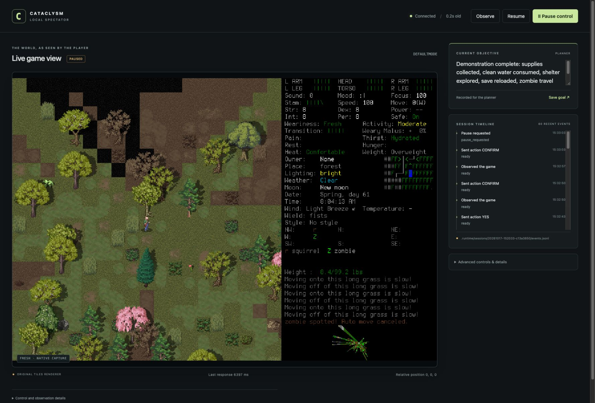

# Understand your first spectator session

This walkthrough explains what to look for. Use [setup](setup.md) for installation
and [start and observe](runbook.md#start-and-observe) for the exact launch commands.
The game stays in a normal window; the browser spectator is another view of it.

## Read the spectator

**Historical example, 2026-10-17 MVP session.** This is the unchanged captured
screenshot, not live state or a new gameplay test. Its byte identity matches the
`spectator-final.png` entry in the [MVP manifest](acceptance/2026-10-17-mvp-manifest.json).
The small copy is tracked so a fresh checkout can illustrate the UI; large video
and journals remain local as described in [acceptance](acceptance/2026-10-17-mvp.md).

1. **Left: what the game actually rendered.** The view includes CDDA's own panels
   and messages. Read outcomes here; a transport acknowledgment alone is insufficient.
2. **Above: observation and control.** The screenshot says paused and shows its
   historical observation age. In a live session, stale/frozen state means you need
   a fresh interpretable observation before continuing.
3. **Recorded objective and recent events.** Recorded intent appears above the
   native frame; edit/save it in the planner panel. Long text scrolls by keyboard.
   The goal records intent for the planner.
   Saving a goal does not launch an autonomous agent. The timeline helps explain
   recent requests; it is not proof that their objectives succeeded.

## Learn one control cycle

After following the launch procedure, **Observe** and compare the spectator with
the native window. Read control ownership and freshness. Give Codex a small goal
in the active chat; explicitly **Resume** when ready. After one bounded action,
inspect the new frame for the actual result or a prompt. Choose the next action
from that observation rather than assuming the previous intent was achieved.

Use **Pause control**, or native keyboard/button input to take over. New remote
inputs stop; an existing native activity may still need interruption in the game
window. If an outcome is unknown, follow [recovery](runbook.md#pause-timeout-and-recovery)
instead of repeating the input. The [action/recovery diagrams](architecture.md#action-and-recovery-views)
explain why these steps matter. This walkthrough adds no survival or combat guarantee.
