# Protected CI profiles

This view separates the required PR gate from post-merge evidence. Unknown
eligibility uses full checks; native/gameplay outcomes remain separate.
[Editable source](../diagrams/ci-validation.mmd).

One always-present Actions `controller` job remains required with its existing App
association and strict main ruleset. Pull-request triggers explicitly target main;
main pushes also run. There are no workflow path filters, conditional required jobs,
manual labels/overrides or ignored failures. Superseded PR runs are cancelled;
running main checks are not cancelled by that policy. `tools/ci.py` chooses a closed
profile from existing Git/GitHub facts and invokes `tools/check.py`. Missing or
ambiguous eligibility selects full; checker or execution failure fails the job.
The [proportional validation brief](../changes/065-proportional-ci.md) records rationale.

All hosted profiles run syntax, selected Ruff, import contracts, JavaScript syntax,
document metadata/local links, current-date strict governance, whitespace and diagram
rendering. Local `--fast` retains calendar-only warnings and omits behavioral tests
and diagram rendering. It is not a hosted profile.

| Profile | Additional executed checks | Supported claim |
| --- | --- | --- |
| Full (also the default local command) | Complete pytest collection of existing unittest cases, four xdist processes with work stealing and 20 slowest durations, plus viewer regressions | Full portable regression; native build/gameplay remain separate |
| Editorial | No runtime tests or viewer regressions | Strict document/structural validation only |
| Movement | Explicit policy and all four direct consumer suites, plus fixed boundary smoke and viewer regressions | Contained movement-policy regression; full regression was not run |
| Viewer | Server and fixed boundary smoke, plus production viewer logic with a synthetic DOM | Contained viewer/boundary regression; no browser layout or full regression claim |
| Main-smoke | Fixed gameplay/evidence/request, ledger and HTTP cases, plus viewer regressions; serial pytest | Bounded smoke on main with linked qualifying full PR coverage; full regression was not rerun on main |

The [testing guide](../testing.md) maps test responsibilities, overlap and upkeep.
`tools/ci.py` owns the exact source allowlists and test targets; the checker consumes
that same manifest. Full and component scopes use four pytest-xdist processes. Full uses built-in
work stealing to balance heterogeneous case durations; component scopes group by
file to keep module/class fixtures together. Main-smoke is serial.
Worker crashes fail the run without restart or silent serial fallback. The pinned
pytest version supports existing unittest assertions, setup/cleanup and subtests.
Collection identity and representative negative matrices are checked when changing
the runner; counts alone do not establish semantic coverage.

Editorial eligibility requires a complete nonempty native Git diff, using the
event's original PR base/head via merge base or main before/after, with
`--no-renames` and NUL-separated paths. Both sides of renames/deletions participate;
every changed object must be regular. The five root documents inspected by the
checker and all `docs/**/*.md` qualify, including current guidance and contracts.
Report assets/JSON under acceptance, assets under docs/assets, and Mermaid source,
SVG and rendered.json directly under docs/diagrams also qualify. Ancillary Markdown
outside the checked set, executable assets, configuration, schemas and registry
JSON do not qualify. Structural consistency cannot prove prose or prompt semantics:
C-REVIEW still checks changed guidance against contracts/source and selects any
needed native/player evidence; running unchanged Python code cannot establish that
new instructions are effective.

A regular diff confined to the explicit movement or viewer allowlist, optionally
with eligible documents, runs that component profile on both PR and main. Movement
includes controller, navigation, skills and supervisor consumers; viewer includes
server/boundary smoke and the Node viewer suite. Changes to both components,
additional source/test helpers, state/persistence/authority, native code, schemas,
dependencies, validation machinery or unknown paths require full PR regression.
Do not infer transitive impact or use manual labels to widen an allowlist. Extending
a boundary requires reviewed consumer coverage and measured benefit. Browser layout
changes retain proportionate rendered review; a synthetic DOM cannot qualify them.

A main editorial or component diff independently executes its selected scope;
it does not borrow a PR pass or claim full coverage. Otherwise main-smoke is
eligible only for an ordinary single-parent squash push adding exactly one commit:
the event's before SHA equals its parent P; exactly one actual merged PR has that
merge SHA, a main base P and head H; P is an ancestor of H; and H's tree equals
actual main. The latest expected `check.yml` pull_request run at H must be completed
and successful, with one successful completed `controller` job, its unique successful
completed `Run strict full validation` step, and an original
`created_at` strictly earlier than the PR's `merged_at`. Equality, malformed times,
a newer failed/cancelled/incomplete run or missing/ambiguous facts require full;
do not search past a newer run for an older success. A successful editorial step
is not full coverage: the earlier run's comparison can differ from the merged PR's
comparison even at the same head. The native step receipt identifies actual full
execution without a new evidence store. The main-only PR trigger,
strict up-to-date protection and default PR merge checkout bind that coverage to
the actual main tree. GitHub's run `pull_requests` list may be empty after merge;
use actual PR/run/Git relationships without fabricating an association.

Changes to validation machinery/context force full on main too: `.github/`, all
engineering `tools/` initially (including checker, selector and package bootstrap),
tests package bootstrap, dependency manifests/locks, renderer
configuration, schemas and control-registry JSON. Covered Markdown alone uses
editorial regardless of whether it describes policy; source changes to implement
that policy are classified separately. This coarse tools boundary avoids maintaining a checker-helper
dependency graph; narrower reuse needs a demonstrated benefit. Normal feature regression tests still receive full PR coverage
but do not alone change validation context. Unknown main paths, nonstandard pushes,
nonregular objects, tree mismatch or unavailable proof select full. Existing pinned
workflow/dependency contracts define the supported environment; no green cache,
provenance service or ambient host fingerprint is introduced. This migration itself
changes validation context and requires full PR and main checks.

Print the selected profile and reason in logs and the Actions summary. Main-smoke
links its qualifying PR run and explicitly reports full regression as unrun on main.
Done requires the appropriate actual PR/main profile and outcome evidence; a reduced
pass never establishes full regression, native support or gameplay acceptance.
Broad source changes always receive full regression before merge. Reuse valid
exact-candidate evidence without duplicating a hosted full pass locally solely for
a checklist; new changes, failures or uncovered risk can require fresh coverage.

[Workflow index](../project-management.md).
