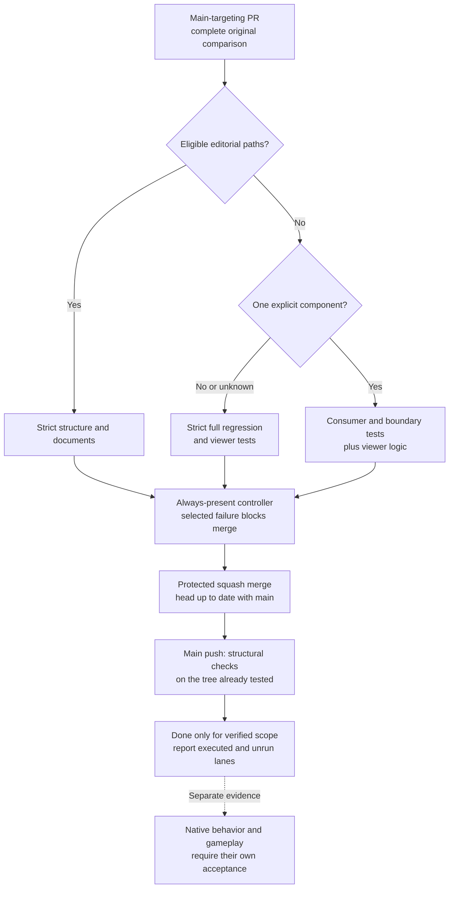

# Protected CI profiles

A pull request runs the narrowest closed profile its complete diff qualifies for; a
push to main runs the structural checks. Native and gameplay outcomes stay separate.

One always-present Actions `controller` job is required by main's ruleset: pull
requests to main only, strict up-to-date status checks, squash merges and no bypass
actors. There are no workflow path filters, conditional required jobs, manual
labels or ignored failures. Superseded pull request runs are cancelled. `tools/ci.py`
chooses a profile from Git facts and invokes `tools/check.py`; missing or ambiguous
eligibility selects full, and a checker or execution failure fails the job.

Every hosted profile runs selected Ruff (including parse errors), import contracts, JavaScript
syntax, document links and checks (`tools/documents.py`), the run ledger, evidence
verification, generated run tables and whitespace. Local `--fast` runs the
same structural checks and nothing else; it is not a hosted profile.

| Profile | Runs on | Additional checks | Supported claim |
| --- | --- | --- | --- |
| Full (also the default local command) | A pull request with any change outside the other profiles | Complete pytest collection on four xdist processes with work stealing and the 20 slowest durations, beside a browser lane: the viewer and investigation suites | Full portable regression; native build and gameplay remain separate |
| Editorial | A pull request changing only eligible documents | None | Document and structural validation only |
| Viewer | A pull request confined to the viewer allowlist, optionally with eligible documents | Server and fixed boundary smoke on four xdist processes grouped by file, beside the browser lane | Contained viewer and boundary regression; no browser layout or full regression claim |
| Main | Every push to main | None; tests already ran on this tree | The tree main received is the pull request head whose run passed |

The [testing guide](../testing.md) maps test responsibilities, overlap and upkeep.
`tools/ci.py` owns the exact source allowlists and test targets; the checker consumes
that same manifest. Worker crashes fail the run without restart or silent serial
fallback. In the full and viewer profiles, the pytest lane and the browser lane run at
once and the run fails after both end if either failed; each lane's output is printed
whole. Interrupting the checker kills both lanes' commands.

**Editorial eligibility.** A complete nonempty Git diff from the pull request's merge
base, with `--no-renames` and NUL-separated paths. Both sides of renames and deletions
count, and every changed object must be regular. The five root documents and all
`docs/**/*.md` qualify, including current guidance and contracts, as do acceptance
assets and JSON, and `docs/assets/` images. Other Markdown, executable assets, configuration
and schemas do not. Structural checks cannot prove prose or prompt
semantics: review compares changed guidance with contracts and source and selects any
needed native or player evidence.

**Viewer eligibility.** A regular diff confined to the explicit viewer allowlist,
optionally with eligible documents. Other source or test helpers, state, persistence,
authority, native code, schemas, dependencies, validation machinery or unknown paths
select full. Do not infer transitive impact or use labels to widen an allowlist;
extending one needs reviewed consumer coverage and measured benefit. Browser layout
changes keep proportionate rendered review; a synthetic DOM cannot qualify them.

**Main pushes.** Strict up-to-date protection makes every pull request head contain
main's tip before it can merge, and serializes merges; a squash merge then gives main
exactly the tree the pull request's required run tested. So a push to main reruns no
tests, and its summary says so. The ruleset is the guarantee: changing it, the
required check or the merge method requires this page and the selector to change
with it. Broad source changes receive full regression before merge, on the pull
request. A reduced profile never establishes full regression, native support or
gameplay acceptance.

Print the selected profile and reason in logs and the Actions summary.

[Workflow index](../project-management.md).
