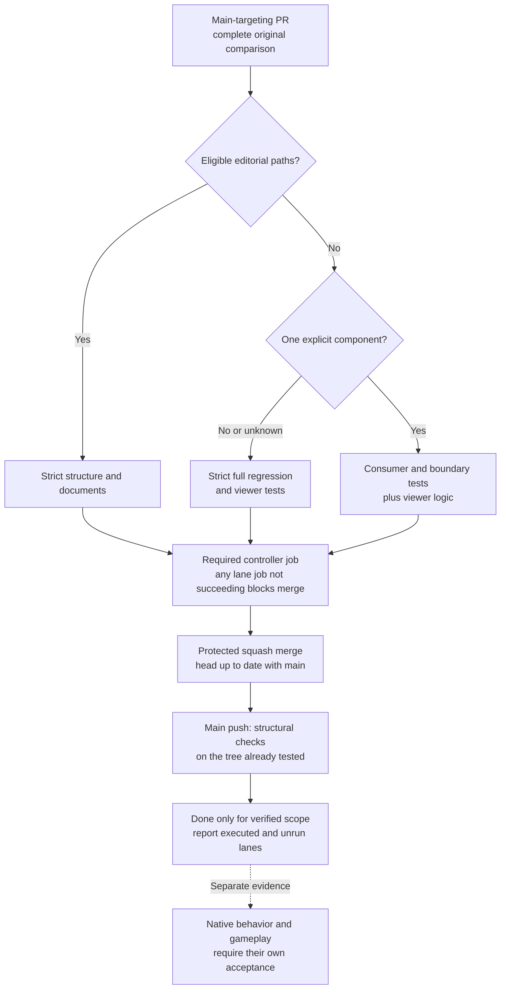
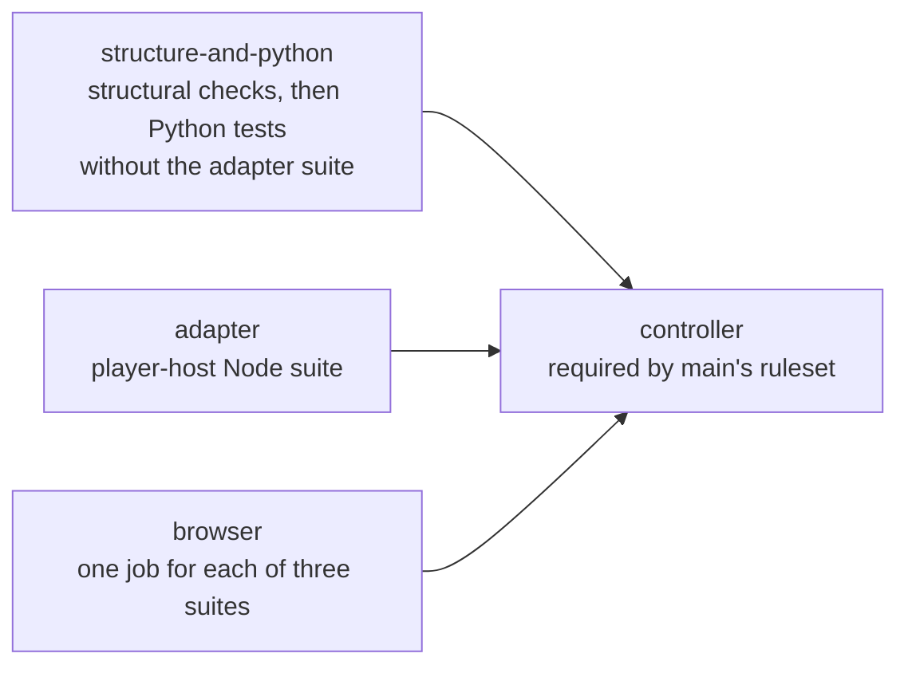

# Protected CI profiles

The diagram answers "which checks does a change get, and what does a merge then rely
on?" Boxes are decisions and checks; arrows mean "leads to".

A pull request runs the narrowest closed profile its complete diff qualifies for; a
push to main runs the structural checks. Native and gameplay outcomes stay separate.

## Jobs of the check

The diagram answers "which jobs run, and which one does the ruleset require?" Boxes
are jobs; arrows mean "must finish before".

**Every lane job always runs.** Each one checks out the commit, runs `tools/ci.py` to
choose the profile from Git facts, installs only what its part of that profile needs
and runs `tools/check.py --profile P --lane L`. When the profile does not use the
lane, that command prints that it has nothing to do and succeeds. No lane job carries
a condition, so a skipped lane is never legitimate. Missing or ambiguous eligibility
selects full, and a checker or execution failure fails its job.

| Lane job | What it runs | Profiles in which it does work |
| --- | --- | --- |
| `structure-and-python` | The structural checks, then the profile's Python tests: in the full profile the complete pytest collection except `tests/test_player_host_adapter.py`, in the viewer profile that profile's tests | All; tests in full and viewer |
| `adapter` | `tests/test_player_host_adapter.py`, which runs the player-host Node suite | Full |
| `browser` | One browser suite on each of three runners: viewer, investigation and investigation session | Full, viewer |

**`controller` is the only job main's ruleset requires**: pull requests to main only,
strict up-to-date status checks, squash merges and no bypass actors. It needs every
lane job, runs under `always()` and passes only if the recorded result of every lane
job is `success`. A failed, cancelled, timed-out or skipped lane job therefore fails
the check. GitHub counts a skipped job as passing a required check, and skips a job
when one it needs fails; `always()` is what keeps `controller` from being skipped,
and so green, in that case. `controller` checks out nothing and trusts each job's
recorded result.

There are no workflow path filters, manual labels or ignored failures, and no job
carries a condition other than `controller`'s `always()`. Superseded pull request
runs are cancelled. [`tools/ci.py`](../../tools/ci.py) holds the table of lanes for
each profile, and `tests/test_ci.py` pins the workflow's shape: the job set, the
`controller` rule, the absence of job conditions, a timeout on every job, and the
installs each lane needs.

On a throwaway workflow with this job shape, five full-profile runs on 12 November
2026 took 108 to 132 seconds (median 117), against about 240 seconds with every lane
in one job. These are measurements, not guarantees; the
[dated record](../acceptance/2026-11-12-parallel-check-jobs.md) has every run.

Every hosted profile runs selected Ruff (including parse errors), import contracts, JavaScript
syntax, document links and checks (`tools/documents.py`), the run ledger, evidence
verification, generated run tables and whitespace. Local `--fast` runs the
same structural checks and nothing else; it is not a hosted profile.

| Profile | Runs on | Additional checks | Supported claim |
| --- | --- | --- | --- |
| Full (also the default local command) | A pull request with any change outside the other profiles | Complete pytest collection on four xdist processes with work stealing and the 20 slowest durations, and the browser suites: viewer and investigation | Full portable regression; native build and gameplay remain separate |
| Editorial | A pull request changing only eligible documents | None | Document and structural validation only |
| Viewer | A pull request confined to the viewer allowlist, optionally with eligible documents | Server and fixed boundary smoke on four xdist processes grouped by file, and the browser suites | Contained viewer and boundary regression; no browser layout or full regression claim |
| Main | Every push to main | None; tests already ran on this tree | The tree main received is the pull request head whose run passed |

The [testing guide](../testing.md) maps test responsibilities, overlap and upkeep.
`tools/ci.py` owns the exact source allowlists and test targets; the checker consumes
that same manifest. Worker crashes fail the run without restart or silent serial
fallback.

**The local command.** `tools/check.py` without `--lane` runs a whole profile on one
machine, and only that is a full local pass. In the full and viewer profiles it runs
pytest and the browser suites at once and fails after both end if either failed; each
one's output is printed whole, and interrupting the checker kills both. With `--lane`
it runs one lane job's part of the profile (the browser lane takes `--suite` for one
suite) and reports that lane only.

**Editorial eligibility.** A complete nonempty Git diff from the pull request's merge
base, with `--no-renames` and NUL-separated paths. Both sides of renames and deletions
count, and every changed object must be regular. The five root documents and all
`docs/**/*.md` qualify, including current guidance and contracts, as do acceptance
assets and JSON, and `docs/assets/` images. Other Markdown, executable assets, configuration
and schemas do not. Structural checks cannot prove prose or prompt
semantics: review compares changed guidance with contracts and source and selects any
needed native or player evidence.

**Viewer eligibility.** A regular diff confined to the explicit viewer allowlist,
optionally with eligible documents. Other source or test helpers, state, persistence,
authority, native code, schemas, dependencies, validation machinery or unknown paths
select full. Do not infer transitive impact or use labels to widen an allowlist;
extending one needs reviewed consumer coverage and measured benefit. Browser layout
changes keep proportionate rendered review; a synthetic DOM cannot qualify them.

**Main pushes.** Strict up-to-date protection makes every pull request head contain
main's tip before it can merge, and serializes merges; a squash merge then gives main
exactly the tree the pull request's required run tested. So a push to main reruns no
tests, and its summary says so: the `structure-and-python` job runs the structural
checks and the other lane jobs report that they have nothing to do. The ruleset is the
guarantee: changing it, the
required check or the merge method requires this page and the selector to change
with it. Broad source changes receive full regression before merge, on the pull
request. A reduced profile never establishes full regression, native support or
gameplay acceptance.

Each lane job prints the selected profile and reason in its log and the Actions summary.

[Workflow index](../project-management.md).
